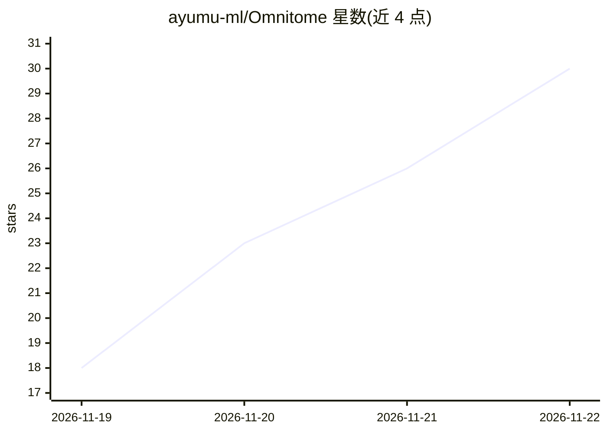

# ayumu-ml/Omnitome

⭐ 30 · JavaScript · AGPL-3.0 · 推送 2026-11-21 · [GitHub](https://github.com/ayumu-ml/Omnitome) · [官网](https://github.com/ayumu-ml/Omnitome/releases) · 个人维护

**本地优先 AI 阅读应用：有界语义压缩+逐句溯源**

面向需要大量阅读技术书籍、论文与非虚构文本的用户，Omnitome 以 Tauri 桌面应用形式提供文档阅读系统：摄取 PDF/EPUB/DOCX/Markdown/RTF/网页 URL 后生成约 7:1 压缩比的压缩章节，每句压缩文本携带 [SOURCE] 溯源徽章，可通过 BGE-M3 重排序锚定回原文段落；缺失溯源的句子以弱化样式标记。支持四套阅读主题、同步句级跟踪的 Kokoro-82M 本地语音朗读。本地模式配合 Ollama/LM Studio 全程离线运行；可选配置 OpenRouter/Gemini 云端合成。仅提供 Windows x64 安装包，未签名会触发 SmartScreen 警告。

## 筛选速览

| 维度 | 判定 | 备注 |
|---|---|---|
| AI 角色 | `ai-native` | 本体是模型或模型工具 |
| 许可风险 | `viral` | AGPL-3.0 |
| 部署形态 | `desktop` | 安装包/桌面程序 |
| 模型依赖 | local-ok | 支持本地模型 |
| 硬件要求 | `gpu-8g` | |
| 安装摩擦 | `medium` | 含编译或系统依赖之一 |
| 成熟度 | — | 结构信号不足 |

## 能力要点

- 约 7:1 有界语义压缩，保留定理、公式与论证
- 逐句确定性溯源徽章，锚定原文段落
- Kokoro-82M 设备端语音朗读与句子同步跟踪
- 本地模式零数据出站；可选云端合成

## 适用场景

- 大量阅读技术书籍与论文，读压缩版并随时核对原文
- 离线/隐私环境下完成文档摄取与语音朗读
- 拖入 PDF/EPUB 等多格式文档建立可过滤的书库

## 场景标签

`语音合成` `文档解析` · 领域:内容生成

## 证据(README 行号)

> L7:  A Local-First Neural Reading System with Loss-Bounded Semantic Compression, Deterministic Vector Provenance, and On
> L171: - **Offline / Local Mode (100% Private):** When paired with a local LLM runner (Ollama or LM Studio), all operatio
> L172: - **Cloud Synthesis Mode (Optional):** When a user explicitly configures a cloud AI provider (OpenRouter or Google

## 星数曲线

2026-11-19 18 → 2026-11-22 30（+12）

---
*卡片 v1 · prompt 1.4 · 生成 2026-11-19 · 置信度 high · 依据 README sha `becd4627fec2` · [字段定义](../../DATASET.md)*
