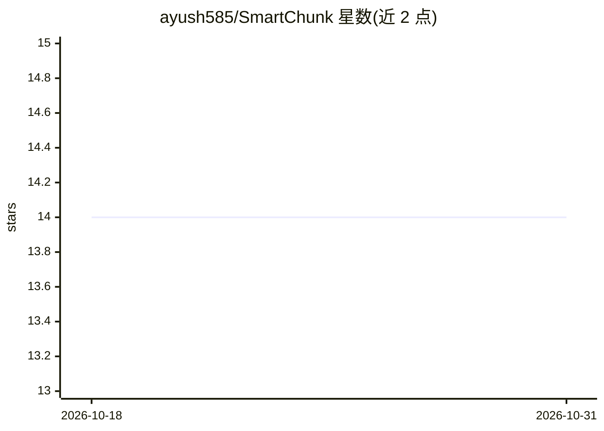

# ayush585/SmartChunk

⭐ 14 · Python · MIT · 推送 2026-02-06 · [GitHub](https://github.com/ayush585/SmartChunk) · [官网](https://test.pypi.org/project/smartchunk/) · 个人维护

**面向 RAG 管线的结构感知语义分块 Python 包与 CLI**

Python 包 + CLI，用于 RAG/LLM 管线中的文本分块：按 markdown 等结构切分，不截断标题、列表、表格与代码块；基于嵌入（默认 all-MiniLM-L6-v2）做语义边界检测；提供去噪去重、参数可调，以及 URL 抓取→解析→清洗→JSONL 分块的端到端命令。CLI 含 fetch/chunk/compare/stream 四个子命令，compare 可输出与朴素切分器的对比。当前仅在 TestPyPI 发布，正式 PyPI 发布为计划项。

## 筛选速览

| 维度 | 判定 | 备注 |
|---|---|---|
| AI 角色 | `ai-ecosystem` | LLM/agent 周边工具 |
| 许可风险 | `permissive` | MIT |
| 部署形态 | `library` | 以包/库形式分发 |
| 模型依赖 | — | README 未给出锁定关系 |
| 硬件要求 | — | 无带数字的原话,不猜 |
| 安装摩擦 | `low` | 无编译、无系统依赖或容器化 |
| 成熟度 | `idea` | |

## 能力要点

- 结构感知切分：不截断标题、列表、表格、代码块
- 基于嵌入的语义边界检测（默认 all-MiniLM-L6-v2）
- 去噪与近重复去除，输出带元数据的 JSONL 分块
- URL 抓取→解析→清洗→分块的端到端单命令流程

## 适用场景

- RAG 入库前生成连贯、带元数据的文本分块
- 对比现有朴素切分器与语义切分的效果
- 从网页 URL 直接抓取并产出分块数据

## 场景标签

 · 领域:LLM 基础设施/RAG

## 证据(README 行号)

> L5: SmartChunk is a **Python package + CLI** that creates higher-quality chunks for Retrieval-Augmented Generation (RAG)
> L25: * **Semantic Boundary Detection**: Uses embeddings to find natural breakpoints between topics.

## 星数曲线

2026-10-18 14 → 2026-10-31 14（+0）

---
*卡片 v1 · prompt 1.4 · 生成 2026-10-31 · 置信度 high · 依据 README sha `2fc842ccb44b` · [字段定义](../../DATASET.md)*
