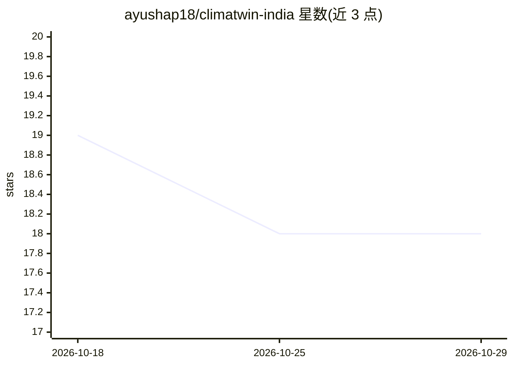

# ayushap18/climatwin-india

⭐ 18 · TypeScript · 推送 2026-06-30 · [GitHub](https://github.com/ayushap18/climatwin-india) · 组织维护

**Delhi-NCR 气候数字孪生：同化观测并用神经集合模拟 1-14 天**

面向 Bharatiya Antariksh Hackathon 2026 的印度气候数字孪生（试点 Delhi-NCR）：镜像格点气候状态、α-nudge 同化观测、以 Persistence/climatology/analog k-NN/双头 ConvLSTM 的 NNLS 堆叠集合做 1-14 天降雨与温度前向模拟，带 split-conformal 90% 区间；用 CorrDiff 风格残差扩散模型将 0.25° 降尺度到 ~5 km。支持合成数据与真实 INSAT-3D/MOSDAC LST（2020，只读观测层）双数据源切换，提供 FastAPI 后端、React 任务控制仪表盘与离线优先的英文自然语言 Agent 控制台。限制：真实 LST 仅 2020 单年、只读、不作预报变量；全记录 LST 为 synthetic_demo 通道。

## 筛选速览

| 维度 | 判定 | 备注 |
|---|---|---|
| AI 角色 | `ai-native` | 本体是模型或模型工具 |
| 许可风险 | `none` | — |
| 部署形态 | `None` |  |
| 模型依赖 | — | README 未给出锁定关系 |
| 硬件要求 | — | 无带数字的原话,不猜 |
| 安装摩擦 | `medium` | 含编译或系统依赖之一 |
| 成熟度 | — | 结构信号不足 |

## 能力要点

- α-nudge 同化 + 前向模拟 + what-if 扰动 + 决策影响的完整孪生循环
- NNLS 堆叠 4 类预报器（含双头 ConvLSTM）并输出 conformal 90% 区间
- CorrDiff 风格残差扩散降尺度 0.25°→5 km，以 FSS/CRPS/功率谱评估
- 离线优先 agentic brain 以英文驱动孪生工具并逐数引证 [tool:field]

## 适用场景

- 查看并模拟 Delhi-NCR 的 1-14 天降雨与温度格点状态
- 运行 ΔTemp/降雨倍增等 what-if 情景并查看决策影响
- 对比各预报器与基线的验证榜单和降尺度效果
- 通过英文命令控制台查询带出处的气候答案

## 场景标签

 · 领域:气候/气象科学计算

## 证据(README 行号)

> L7: > **Not a forecast model — a digital twin.** It mirrors a live gridded climate state, **assimilates**
> L52: |🧠 **No single model wins — so we stack honestly**|Persistence, climatology, **analog k-NN** and a **two-head ConvL
> L53: |🔬 **Generative downscaling, scored right**|A **CorrDiff-style residual diffusion** model super-resolves 0.25° → **

## 星数曲线

2026-10-18 19 → 2026-10-29 18（-1）

---
*卡片 v1 · prompt 1.4 · 生成 2026-10-29 · 置信度 high · 依据 README sha `a1bb2ae8ce2f` · [字段定义](../../DATASET.md)*
