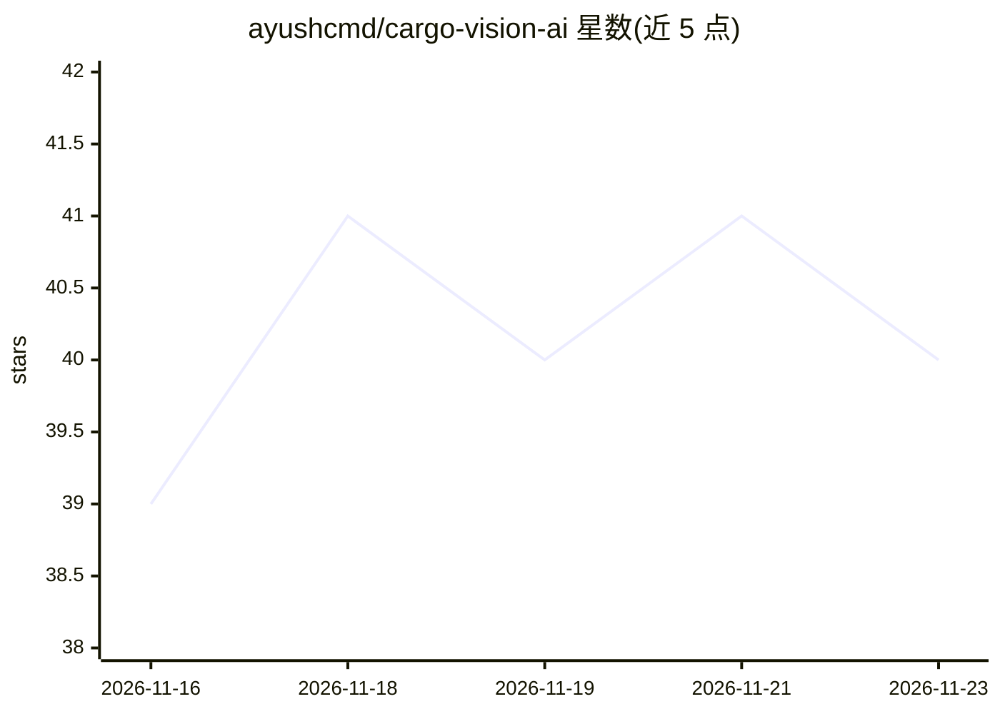

# ayushcmd/cargo-vision-ai

⭐ 40 · Python · Apache-2.0 · 推送 2026-11-21 · [GitHub](https://github.com/ayushcmd/cargo-vision-ai) · 个人维护

**本地优先的铁路货车视觉检测平台：车厢计数、编号OCR、缺陷检测**

面向铁路货运场站的自动化滚动库存检测引擎：YOLOv8 定位车厢并防重复计数，专用子检测器裁剪 11 位编号牌，EasyOCR 识别后按印度铁路 Modulo-10 校验和验证；Zero-DCE/NAFNet 做低光增强与去模糊，缺陷检测器标记门未关、弹簧断裂、轴盖故障，结果写入 SQLite 审计库并可一键生成 FPDF2 PDF 合规报告。全部推理本地运行，无需云 API。FastAPI 后端 + React 19 前端，含 Python/Node.js 依赖，从源码运行。README 声明其为辅助人工检查的技术研究原型，非认证安全系统。

## 筛选速览

| 维度 | 判定 | 备注 |
|---|---|---|
| AI 角色 | `ai-native` | 本体是模型或模型工具 |
| 许可风险 | `permissive` | Apache-2.0 |
| 部署形态 | `desktop` | 安装包/桌面程序 |
| 模型依赖 | — | README 未给出锁定关系 |
| 硬件要求 | — | 无带数字的原话,不猜 |
| 安装摩擦 | `medium` | 含编译或系统依赖之一 |
| 成熟度 | `idea` | |

## 能力要点

- 级联流水线：亮度路由（Zero-DCE/SCI）→ 车厢检测 → 编号裁剪 → NAFNet 去模糊 → OCR → 校验和验证
- 11 位编号解析车厢类型、所属路局、制造年份与序列号（Modulo-10 校验）
- 结构缺陷检测（未关门、弹簧断裂、轴盖故障）关联到车厢 ID
- SQLite 不可变审计台账与一键 PDF 合规报告，8 个模型权重随仓库提供（147.78 MB）

## 适用场景

- 轨道旁相机视频自动计数货车并登记编号
- 夜间或低光环境下的车厢编号识别与增强
- 自动标记结构缺陷并生成巡检报告供人工复核

## 场景标签

`目标检测` `OCR` `图像视频处理` · 领域:感知与多模态

## 证据(README 行号)

> L40: **CargoVision AI** is a specialized computer-vision inspection engine designed to automate trackside rolling stock 
> L27: > **Local-First Architecture:** CargoVision AI executes entirely on your local workstation without external cloud s

## 星数曲线

2026-11-16 39 → 2026-11-23 40（+1）

---
*卡片 v1 · prompt 1.4 · 生成 2026-11-18 · 置信度 high · 依据 README sha `4c1960104d83` · [字段定义](../../DATASET.md)*
