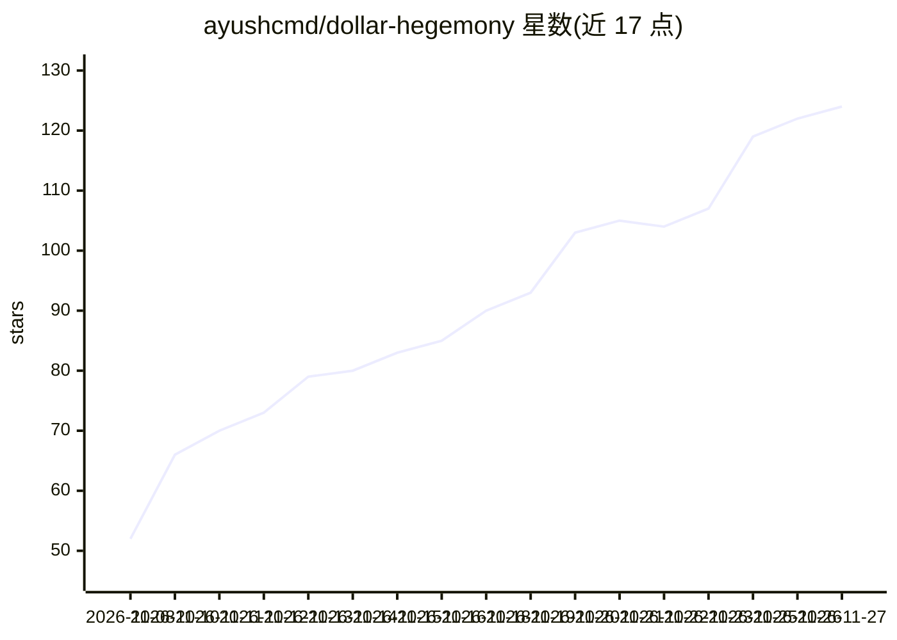

# ayushcmd/dollar-hegemony

⭐ 124 · Python · Apache-2.0 · 推送 2026-11-17 · [GitHub](https://github.com/ayushcmd/dollar-hegemony) · [官网](https://huggingface.co/spaces/Ayush0826/dollar-hegemony) · 个人维护

**分析美元主导地位对 BRICS/G7 汇率压力的 ML 研究系统**

交互式宏观金融 ML 研究系统：构建美元压力综合指标 DSI（标准化因子加权合成），用 XGBoost 与 LSTM 混合模型估计各国货币对美元的贬值与压力传导，时间覆盖 2000–2024。面向经济学研究者，以 Plotly Dash 仪表盘 + FastAPI 后端形式提供七大模块：宏观、模型、情景模拟、世界地图、危机告警、基本面与新闻。数据来自 Yahoo Finance、FRED、世界银行与实时新闻。声明仅为研究/分析工具，非投资建议；机制切换时期会降低历史模型可靠性。

## 筛选速览

| 维度 | 判定 | 备注 |
|---|---|---|
| AI 角色 | `ai-native` | 本体是模型或模型工具 |
| 许可风险 | `permissive` | Apache-2.0 |
| 部署形态 | `self-host` | docker 或自建部署 |
| 模型依赖 | — | README 未给出锁定关系 |
| 硬件要求 | — | 无带数字的原话,不猜 |
| 安装摩擦 | `low` | 无编译、无系统依赖或容器化 |
| 成熟度 | — | 结构信号不足 |

## 能力要点

- 美元压力指数 DSI：标准化因子加权合成，划分压力区间
- XGBoost + LSTM 混合模型做国别贬值与方向预测
- 情景模拟器：用户控制 DXY 水平与 12 个月动量
- 七大仪表盘模块含世界地图、危机告警与实时新闻

## 适用场景

- 研究美元强弱对 BRICS 各国货币压力的传导
- 模拟强/弱美元情景下的 12 个月贬值影响
- 追踪危机时期各国汇率告警状态与历史表现

## 场景标签

`金融量化` · 领域:学习与行业

## 证据(README 行号)

> L11: An interactive macro-financial ML research system that tracks USD strength, estimates stress transmission across BR
> L25: - **Hybrid model layer:** XGBoost + LSTM

## 星数曲线

2026-11-08 52 → 2026-11-27 124（+72）

---
*卡片 v1 · prompt 1.4 · 生成 2026-11-18 · 置信度 mid · 依据 README sha `43d256616666` · [字段定义](../../DATASET.md)*
