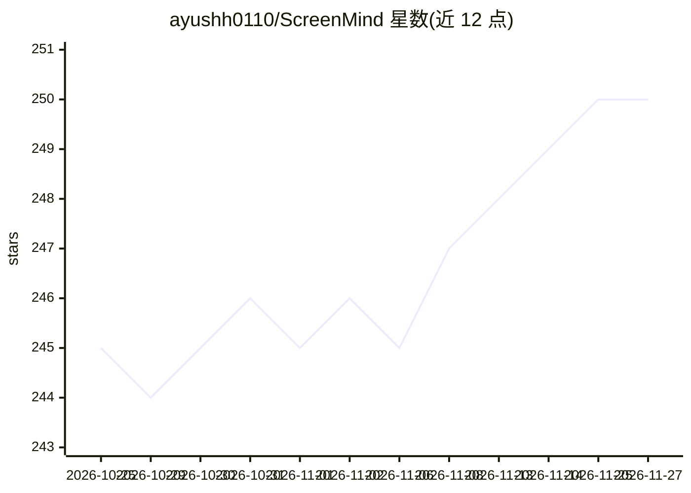

# ayushh0110/ScreenMind

⭐ 250 · Python · MIT · 推送 2026-11-03 · [GitHub](https://github.com/ayushh0110/ScreenMind) · [官网](https://screenmind.space/) · 个人维护

**本地屏幕记忆工具：截图分析、可搜索历史与对话**

持续捕获屏幕内容，用本地运行的 Gemma 4 多模态模型生成结构化分析（应用识别、活动分类、场景描述、布局区域），构建可语义与关键词混合检索的屏幕历史，并支持 RAG 对话、语音备忘与会议转写。模型经 llama.cpp 生态的 llama-server 运行，全部推理在本机完成，截图以 AES 加密存储并提供敏感信息自动脱敏、无痕模式与自动保留期删除。首次启动时自动下载 AI 依赖包与 llama-server，通过内置 Model Hub 下载 GGUF 模型。提供 MCP Server 将屏幕历史暴露给 Claude Desktop、Cursor、VS Code。

## 筛选速览

| 维度 | 判定 | 备注 |
|---|---|---|
| AI 角色 | `ai-native` | 本体是模型或模型工具 |
| 许可风险 | `permissive` | MIT |
| 部署形态 | `library` | 以包/库形式分发 |
| 模型依赖 | local-ok | 支持本地模型 |
| 硬件要求 | `gpu-8g` | |
| 安装摩擦 | `medium` | 含编译或系统依赖之一 |
| 成熟度 | — | 结构信号不足 |

## 能力要点

- 单模型（Gemma 4 E2B/E4B/12B）覆盖视觉分析、音频转写与推理
- 内容变化触发的智能捕获，带 pHash 缓存与重负载应用自动暂停
- 语义（MiniLM）+ FTS5 关键词混合搜索与对话式 RAG
- MCP Server 可对接 Claude Desktop、Cursor、VS Code

## 适用场景

- 回顾一天中看过或用过的屏幕内容
- 直接询问屏幕历史中的具体信息（如某条消息内容）
- 录制并转写会议，生成结构化摘要
- 通过 MCP 让编辑器/助手读取屏幕历史

## 场景标签

`RAG` `语音识别` `知识库管理` · 领域:知识与检索

## 证据(README 行号)

> L3: **Captures your screen → Analyzes with Gemma 4 → Builds a searchable AI memory**
> L39: - **💬 Chat with Memory** — Conversational RAG with follow-up support. Ask "what did Alex say on Discord?" → get the
> L195: - Auto-detect your GPU and download `llama-server` if not found (CUDA/CPU auto-selected)

## 星数曲线

2026-10-25 245 → 2026-11-27 250（+5）

---
*卡片 v1 · prompt 1.4 · 生成 2026-11-25 · 置信度 high · 依据 README sha `8841a900593b` · [字段定义](../../DATASET.md)*
