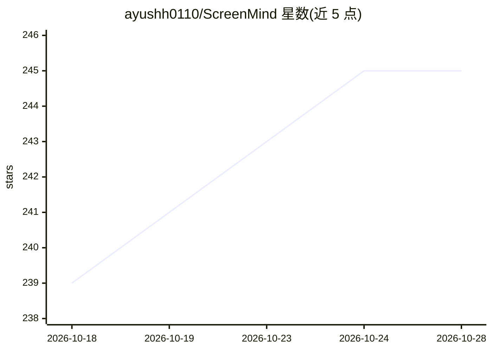

# ayushh0110/ScreenMind

⭐ 244 · Python · MIT · 推送 2026-10-15 · [GitHub](https://github.com/ayushh0110/ScreenMind) · [官网](https://screenmind.space/) · 个人维护

**本地屏幕记忆应用：截图分析+语义搜索+对话问答**

面向个人用户的屏幕活动记录与检索工具：基于内容变化检测捕获屏幕截图，用 Gemma 4 多模态模型（E2B/E4B/12B，经 llama.cpp 推理）分析应用、活动类别、场景与布局，构建语义（MiniLM）+FTS5 混合索引，支持对话式 RAG 问答、语音备忘与会议转录、每日摘要与分析面板。全部本地运行，无遥测；提供敏感信息自动脱敏、AES 加密、PIN 锁定与保留期删除。pip 安装，支持 Windows/macOS/Linux，需 Python 3.10+，GPU 推荐 4GB+ VRAM（可纯 CPU）。

## 筛选速览

| 维度 | 判定 | 备注 |
|---|---|---|
| AI 角色 | `ai-native` | 本体是模型或模型工具 |
| 许可风险 | `permissive` | MIT |
| 部署形态 | `library` | 以包/库形式分发 |
| 模型依赖 | local-ok | 支持本地模型 |
| 硬件要求 | `gpu-8g` | |
| 安装摩擦 | `medium` | 含编译或系统依赖之一 |
| 成熟度 | — | 结构信号不足 |

## 能力要点

- Gemma 4 单模型承担视觉+音频+推理，E2B 默认（~4GB VRAM）
- 语义嵌入+FTS5 混合搜索与对话式 RAG（支持追问与视觉回退）
- 语音备忘与会议转录（检测 Zoom/Teams/Webex/Slack/Discord，默认关闭）
- 隐私机制：本地处理、PII 正则脱敏、AES 加密、数据保留期自动删除

## 适用场景

- 回溯查找'刚才在屏幕上看到过什么'的内容
- 询问屏幕历史中的具体信息（如某条聊天消息）
- 本地记录并总结会议，无需云端服务

## 场景标签

`语义搜索` `语音识别` `聊天机器人` · 领域:对话与助手

## 证据(README 行号)

> L3: **Captures your screen → Analyzes with Gemma 4 → Builds a searchable AI memory**
> L37: - **🔬 Gemma 4 Vision Analysis** — Every screenshot analyzed: app detection, activity categorization, mood, scene de
> L39: - **💬 Chat with Memory** — Conversational RAG with follow-up support. Ask "what did Alex say on Discord?" → get the

## 星数曲线

2026-10-18 239 → 2026-10-28 245（+6）

---
*卡片 v1 · prompt 1.4 · 生成 2026-10-22 · 置信度 high · 依据 README sha `7c4c67828fbb` · [字段定义](../../DATASET.md)*
