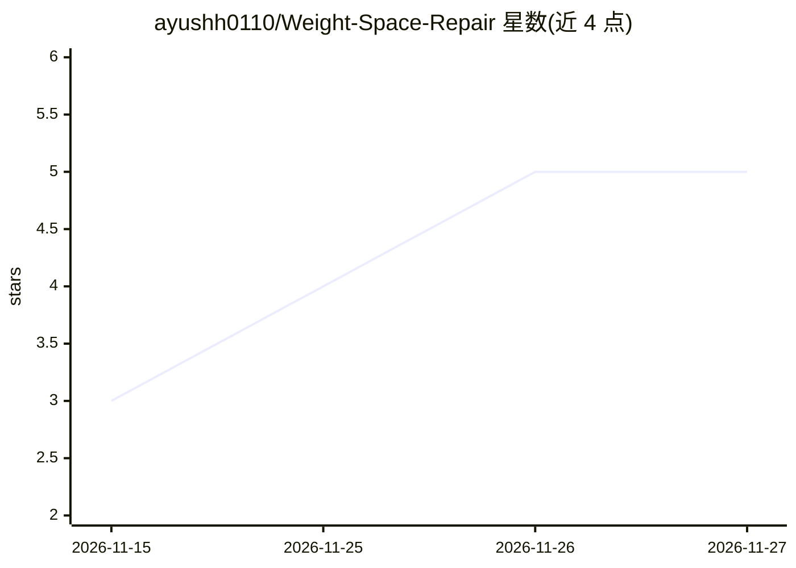

# ayushh0110/Weight-Space-Repair

⭐ 5 · Python · MIT · 推送 2026-11-23 · [GitHub](https://github.com/ayushh0110/Weight-Space-Repair) · 个人维护

**诊断并修复开源权重 LLM 输出故障的调试 CLI**

wsr 针对开源权重模型的不良回复（空白、循环、错语言、误拒答）逐层排查：聊天模板、采样设置、截断上下文、量化张量，输出单一原因与修复建议；通过全部排查的故障会在全精度网络内定位并生成修复（权重补丁、激活转向或服务设置）。修复需在留出数据上通过配对统计判定与确认集，附 MANIFEST.json 记录判定过程。triage 层无 GPU 无依赖即可运行，深度诊断需 torch extra；当前为 beta，测试限于 1.5B 以下模型。

## 筛选速览

| 维度 | 判定 | 备注 |
|---|---|---|
| AI 角色 | `ai-ecosystem` | LLM/agent 周边工具 |
| 许可风险 | `permissive` | MIT |
| 部署形态 | `library` | 以包/库形式分发 |
| 模型依赖 | local-ok | 支持本地模型 |
| 硬件要求 | — | 无带数字的原话,不猜 |
| 安装摩擦 | `medium` | 含编译或系统依赖之一 |
| 成熟度 | `idea` | |

## 能力要点

- 七层 triage 排查并给出单一原因与修复，无 GPU、无依赖
- GGUF 张量级量化故障二分定位（qbisect）
- 修复仅在留出数据统计判定与确认集通过后才发布，附 MANIFEST.json
- 修补丁绑定制作时使用的精确权重，拒绝应用于其他权重

## 适用场景

- 排查本地部署 LLM 出现空白或循环回复的原因
- 定位量化模型中引起拒答或损坏输出的张量
- 对模型误拒答/漏拒答问题生成并通过统计判定后应用转向或权重修复

## 场景标签

 · 领域:LLM 工具/调试与可解释性

## 证据(README 行号)

> L7: When an open-weight model gives a bad reply (blank, looping, the wrong language, a refusal of a harmless
> L18: |Is it my setup or the model?|`wsr triage`|one cause and its fix|nothing: no GPU, no dependencies|
> L55: A rule-based playbook goes first; a model with weight-editing tools (a frontier model, or a local one behind any

## 星数曲线

2026-11-15 3 → 2026-11-27 5（+2）

---
*卡片 v1 · prompt 1.4 · 生成 2026-11-22 · 置信度 high · 依据 README sha `400ac51dd93b` · [字段定义](../../DATASET.md)*
