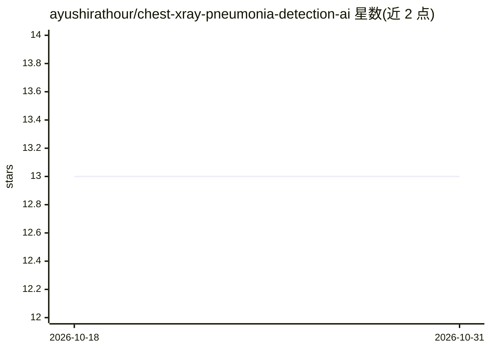

# ayushirathour/chest-xray-pneumonia-detection-ai

⭐ 13 · Python · MIT · 推送 2026-08-14 · [GitHub](https://github.com/ayushirathour/chest-xray-pneumonia-detection-ai) · [官网](https://pneumodetectai.streamlit.app) · 个人维护

**儿科胸片肺炎检测模型与应用，含跨操作者验证**

基于 TensorFlow/MobileNetV2 迁移学习的儿科（1-5 岁）胸片肺炎分类系统：模型 14MB，训练于 2018 年数据（5,863 图），在 2024 年独立重标注的 485 例跨操作者队列上验证，报告 86% 准确率、96.4% 灵敏度，附 bootstrap AUC 统计检验与可复现文件（Zenodo DOI）。交付形态包括 Streamlit 网页、FastAPI REST API（/predict 等端点）、Hugging Face Hub 托管的预训练模型及自行训练脚本。数据集不随仓库分发，需从 Kaggle 手动下载。

## 筛选速览

| 维度 | 判定 | 备注 |
|---|---|---|
| AI 角色 | `ai-native` | 本体是模型或模型工具 |
| 许可风险 | `permissive` | MIT |
| 部署形态 | `library` | 以包/库形式分发 |
| 模型依赖 | — | README 未给出锁定关系 |
| 硬件要求 | — | 无带数字的原话,不猜 |
| 安装摩擦 | `low` | 无编译、无系统依赖或容器化 |
| 成熟度 | — | 结构信号不足 |

## 能力要点

- MobileNetV2 迁移学习模型（14MB），输出肺炎/正常分类与置信度
- 独立跨操作者验证集（485 例，2024 年重标注）与 bootstrap 统计检验
- FastAPI 接口（POST /predict）与 Streamlit 前端，支持 DICOM 与 PDF 报告
- 预训练模型经 Hugging Face Hub 分发

## 适用场景

- 上传儿科胸片获得肺炎筛查结果与 AI 注意力图
- 开发者通过 REST API 集成肺炎检测能力
- 复现或扩展医学影像跨操作者验证实验

## 场景标签

 · 领域:医疗 AI/医学影像

## 证据(README 行号)

> L127: * **Model Training** using transfer learning with MobileNetV2 backbone
> L180: * `POST /predict` uploads X-ray image for pneumonia detection

## 星数曲线

2026-10-18 13 → 2026-10-31 13（+0）

---
*卡片 v1 · prompt 1.4 · 生成 2026-10-31 · 置信度 high · 依据 README sha `d082d0a1f3a3` · [字段定义](../../DATASET.md)*
