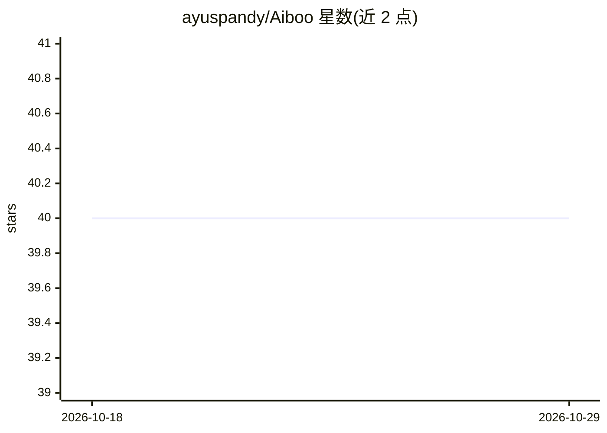

# ayuspandy/Aiboo

⭐ 40 · Kotlin · Apache-2.0 · 推送 2026-08-27 · [GitHub](https://github.com/ayuspandy/Aiboo) · [官网](https://github.com/binarybeam/Aiboo/releases/download/1.0.0/aiboo.apk) · 个人维护

**安卓端 AI Agent：用自然语言指令在设备后台执行任务**

基于 Kotlin 的 Android AI 代理应用，接入 Google Gemini API 理解语音或文本指令，在设备后台执行任务：点餐、打车、发推特、打电话/短信、启动应用、拍照截屏、快捷操作（手电筒/音量/亮度等）、设置闹钟提醒、文件操作及数据分析。后台操作由 Prexocore 工具库承担（权限、视图、文件 IO、系统动作）。API key 仅本地存储。通过 Android Studio 克隆源码构建运行，需 API 24+ 设备与 Gemini API key。

## 筛选速览

| 维度 | 判定 | 备注 |
|---|---|---|
| AI 角色 | `ai-native` | 本体是模型或模型工具 |
| 许可风险 | `permissive` | Apache-2.0 |
| 部署形态 | `None` |  |
| 模型依赖 | — | README 未给出锁定关系 |
| 硬件要求 | — | 无带数字的原话,不猜 |
| 安装摩擦 | `low` | 无编译、无系统依赖或容器化 |
| 成熟度 | — | 结构信号不足 |

## 能力要点

- 自然语言/语音指令驱动，任务在后台自动执行
- 覆盖点餐、打车、社交发布、通讯、文件操作、设备快捷操作等任务类型
- Prexocore 库处理权限、视图操作、文件 IO 与系统动作
- Gemini API key 仅本地存储，声明无静默数据上传

## 适用场景

- 用一句话让手机代为点餐或叫车
- 语音控制设备快捷操作，如开手电筒、调亮度
- 设置提醒、管理文件等日常设备任务

## 场景标签

`GUI 自动化` · 领域:效率与自动化

## 证据(README 行号)

> L3: **Aiboo** is a Kotlin-based Android AI agent that can understand natural language commands and perform tasks on your
> L27: * **Input:** Voice or text query

## 星数曲线

2026-10-18 40 → 2026-10-29 40（+0）

---
*卡片 v1 · prompt 1.4 · 生成 2026-10-25 · 置信度 high · 依据 README sha `93750989f671` · [字段定义](../../DATASET.md)*
