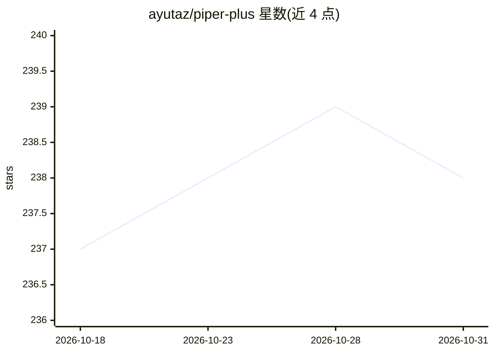

# ayutaz/piper-plus

⭐ 238 · Python · MIT · 推送 2026-10-30 · [GitHub](https://github.com/ayutaz/piper-plus) · [官网](https://ayutaz.github.io/piper-plus/) · 个人维护 · 中文 README

**多语言神经 TTS 系统：为开发者在 8 种语言运行时中生成语音**

基于 VITS 架构的神经文本转语音系统，是 rhasspy/piper 的 MIT 许可分支。支持 8 语言 G2P 音素化（JA/EN/ZH/KO/ES/FR/PT/SV），现役训练模型覆盖 6 语言，含 OpenJTalk 日语集成与韵律特征。以 6 种运行时（Python/Rust/C#/Go/WASM/C++）交付：pip/cargo/npm/dotnet tool 安装、预编译二进制、Docker 镜像、C API/iOS SPM 库。支持流式合成、音素时间输出、SSML、多 GPU 训练。限制：voice cloning 的 --reference-audio 在 C++ 未实现，zs-v1 模型标注为实验版、质量未承认定版。

## 筛选速览

| 维度 | 判定 | 备注 |
|---|---|---|
| AI 角色 | `ai-native` | 本体是模型或模型工具 |
| 许可风险 | `permissive` | MIT |
| 部署形态 | `desktop` | 安装包/桌面程序 |
| 模型依赖 | — | README 未给出锁定关系 |
| 硬件要求 | — | 无带数字的原话,不猜 |
| 安装摩擦 | `low` | 无编译、无系统依赖或容器化 |
| 成熟度 | `idea` | |

## 能力要点

- 8 语言 G2P 音素化，现役模型 6 语言、571 说话者
- 6 种运行时（Python/Rust/C#/Go/WASM/C++）提供 CLI/库/HTTP API
- 流式合成、音素时间输出（JSON/TSV/SRT）、SSML 支持
- 预编译二进制覆盖 Windows/macOS/Linux x64/ARM64，Docker 镜像 5 种

## 适用场景

- 在本地或浏览器（WASM）离线生成多语言语音
- 通过 C API/SPM/FFI 将 TTS 嵌入移动端或游戏应用
- 训练或微调自己的 VITS 多说话者模型
- 为应用提供 HTTP API 形式的语音合成服务

## 场景标签

`语音合成` `微调` · 领域:内容生成

## 证据(README 行号)

> L24: 高速・高品質なニューラルテキスト音声合成 (TTS) システム。VITS アーキテクチャを採用し、8言語のG2P/音素化と、現在6言語の学習済みモデルによるマルチスピーカー音声合成に対応。Piper のフォークで、日本語対応・音質
> L94: - **PyPI** — `pip install piper-plus` で簡単インストール、8言語G2P/音素化 (現行の学習済みモデルは6言語)、**音素タイミング出力 (JSON/TSV/SRT)**、ストリーミング、HT

## 星数曲线

2026-10-18 237 → 2026-10-31 238（+1）

---
*卡片 v1 · prompt 1.4 · 生成 2026-10-22 · 置信度 high · 依据 README sha `ee4e7fb827da` · [字段定义](../../DATASET.md)*
