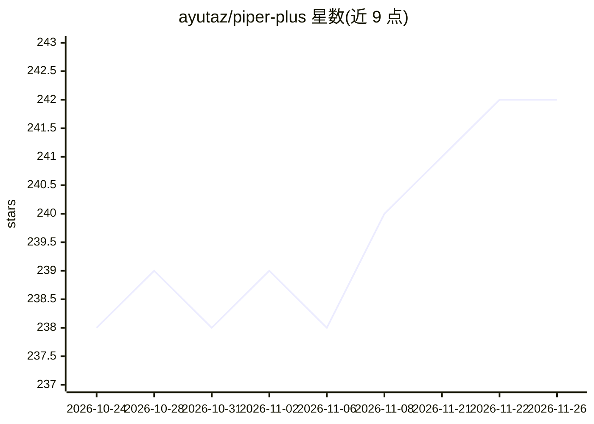

# ayutaz/piper-plus

⭐ 242 · Python · MIT · 推送 2026-11-21 · [GitHub](https://github.com/ayutaz/piper-plus) · [官网](https://ayutaz.github.io/piper-plus/) · 个人维护

**多语言神经 TTS 库：文本转语音，支持 6 语言与多运行时**

基于 VITS 架构的神经 TTS 系统，是 rhasspy/piper 的 MIT 许可分支；提供 8 语言 G2P/音素化与 6 语言（JA/EN/ZH/ES/FR/PT）预训练模型、多说话人合成、流式输出与音素时间戳导出（JSON/TSV/SRT）。以 Python/C++/C#/Rust/Go/WASM 六种运行时分发，覆盖 PyPI、npm、crates.io、NuGet、.NET tool 与预编译二进制；另含 Gradio WebUI、Docker 镜像、训练/微调功能与 iOS Swift 包。原版 piper 已归档，此分支不依赖 espeak-ng。

## 筛选速览

| 维度 | 判定 | 备注 |
|---|---|---|
| AI 角色 | `ai-native` | 本体是模型或模型工具 |
| 许可风险 | `permissive` | MIT |
| 部署形态 | `desktop` | 安装包/桌面程序 |
| 模型依赖 | — | README 未给出锁定关系 |
| 硬件要求 | — | 无带数字的原话,不猜 |
| 安装摩擦 | `low` | 无编译、无系统依赖或容器化 |
| 成熟度 | — | 结构信号不足 |

## 能力要点

- 8 语言 G2P，6 语言预训练模型，571 说话人多说话人合成
- 六种运行时（Python/C++/C#/Rust/Go/WASM），浏览器 WASM 无需服务器
- 流式合成与音素时间戳输出（JSON/TSV/SRT），内置 200+ 术语发音词典
- 提供训练/微调功能：WavLM Discriminator、MB-iSTFT Decoder、多 GPU DDP

## 适用场景

- 为应用嵌入本地文本转语音，含日语/中文等多语言场景
- 在浏览器端运行 TTS（WASM，无需后端）
- 用自有语音数据微调自定义多说话人模型
- 通过 Wyoming 镜像接入 Home Assistant 语音流程

## 场景标签

`语音合成` `微调` · 领域:内容生成

## 证据(README 行号)

> L24: 高速・高品質なニューラルテキスト音声合成 (TTS) システム。VITS アーキテクチャを採用し、8言語のG2P/音素化と、現在6言語の学習済みモデルによるマルチスピーカー音声合成に対応。Piper のフォークで、日本語対応・音質
> L68: - **8言語G2P/音素化対応** — 日本語・英語・中国語・スペイン語・フランス語・ポルトガル語・スウェーデン語・韓国語 (ja=0, en=1, zh=2, es=3, fr=4, pt=5, sv=6, ko=7)。現行の
> L94: - **PyPI** — `pip install piper-plus` で簡単インストール、8言語G2P/音素化 (現行の学習済みモデルは6言語)、**音素タイミング出力 (JSON/TSV/SRT)**、ストリーミング、HT

## 星数曲线

2026-10-24 238 → 2026-11-26 242（+4）

---
*卡片 v1 · prompt 1.4 · 生成 2026-11-25 · 置信度 high · 依据 README sha `9c4071fd5db2` · [字段定义](../../DATASET.md)*
