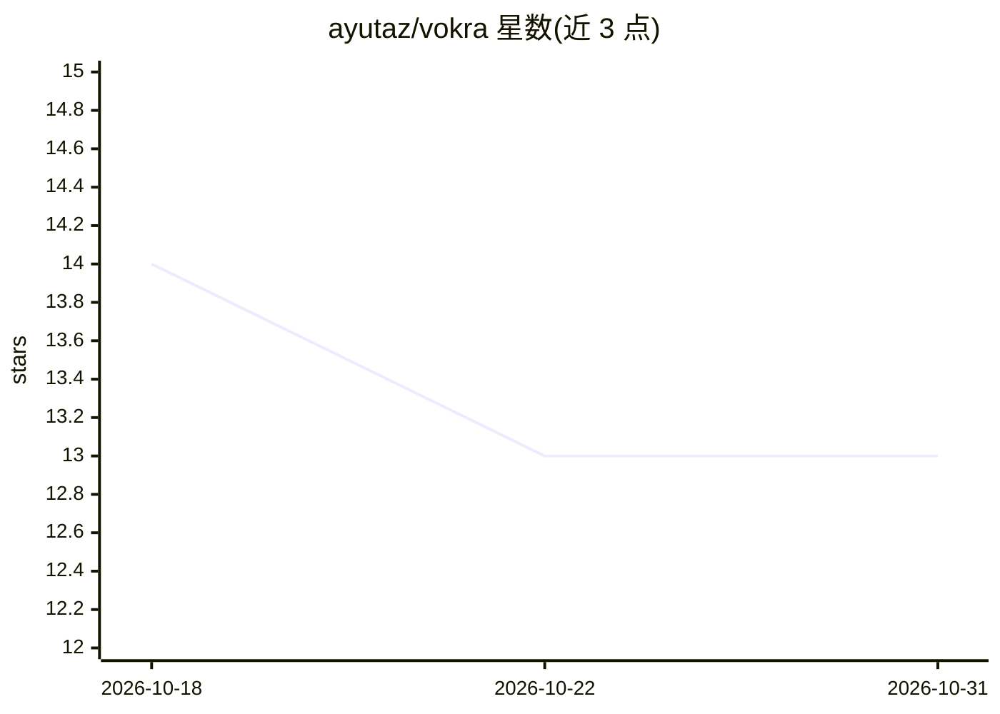

# ayutaz/vokra

⭐ 13 · Rust · Apache-2.0 · 推送 2026-10-26 · [GitHub](https://github.com/ayutaz/vokra) · 个人维护

**Rust 编写的语音优先推理运行时，直接加载 GGUF**

用 Rust 实现的语音推理运行时，原生提供流式状态、STFT/iSTFT 与 mel 前端、声码器、神经编解码、CTC/RNN-T 解码、VAD、说话人特征与音频增强等算子。运行时不加载 ONNX 图，直接读取记录来源与许可信息的 GGUF 文件；默认运行时无第三方 Cargo 依赖。CPU 为默认后端，Metal/CUDA/Vulkan/WebGPU 为可选。提供 C ABI 供 Unity、Godot、Python 等集成，C ABI 处于 pre-1.0 未冻结状态；v0.4.0-rc.1 仅提供 Linux CLI 的 CPU 评估预览，功能核验覆盖 Whisper base ASR 与 Silero VAD v5。

## 筛选速览

| 维度 | 判定 | 备注 |
|---|---|---|
| AI 角色 | `ai-ecosystem` | LLM/agent 周边工具 |
| 许可风险 | `permissive` | Apache-2.0 |
| 部署形态 | `None` |  |
| 模型依赖 | — | README 未给出锁定关系 |
| 硬件要求 | — | 无带数字的原话,不猜 |
| 安装摩擦 | `high` | 编译与系统依赖俱全 |
| 成熟度 | `idea` | |

## 能力要点

- 语音前端/解码/声码器/VAD 等均为原生算子而非 ONNX 图胶水
- 直接加载 GGUF（含来源、量化策略与许可元数据），运行时零第三方 Cargo 依赖
- 生成 C 头文件，支持 Unity/Godot/Python/Swift 等绑定集成
- GPU 不可用或算子不支持时显式报错，不静默回退 CPU

## 适用场景

- 在 Unity/Godot 游戏或移动端嵌入本地 ASR/TTS/VAD 推理
- 寻找不依赖 ONNX 图、直接加载 GGUF 的语音推理运行时
- 需要记录模型来源与许可信息的可复现模型交付流程

## 场景标签

`语音识别` `语音合成` `推理引擎` · 领域:内容生成

## 证据(README 行号)

> L8: Vokra is a speech-first inference runtime written in Rust. It implements the
> L14: Vokra loads provenance-aware GGUF files and does not load ONNX graphs at
> L68: cargo build --release -p vokra-capi

## 星数曲线

2026-10-18 14 → 2026-10-31 13（-1）

---
*卡片 v1 · prompt 1.4 · 生成 2026-10-31 · 置信度 high · 依据 README sha `57615c2892b2` · [字段定义](../../DATASET.md)*
