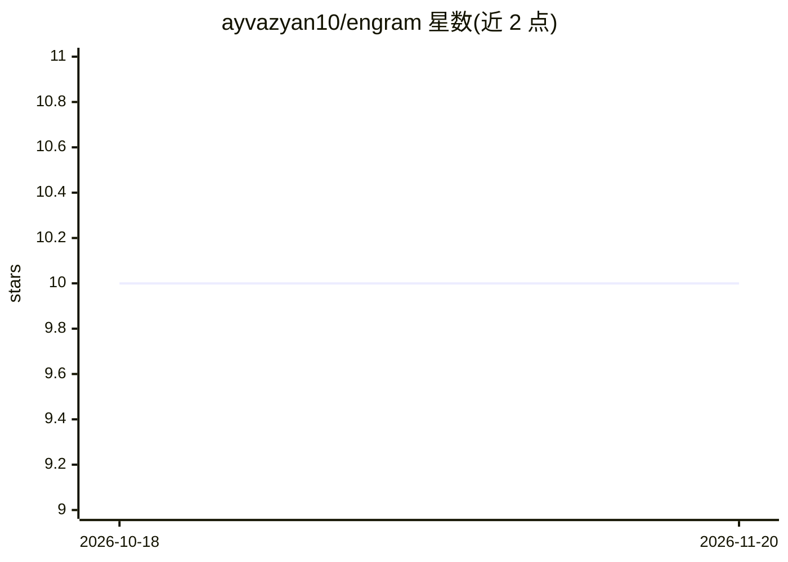

# ayvazyan10/engram

⭐ 10 · TypeScript · MIT · 推送 2026-11-15 · [GitHub](https://github.com/ayvazyan10/engram) · [官网](https://engram.am) · 个人维护

**为 AI 模型提供跨会话持久记忆的通用后端**

Engram 是一个持久化记忆与认知层，以 MCP 服务器、REST API 和 CLI 形式运行在本地（SQLite 存储，REST 端口 4901）。它存储情景/语义/程序性三类记忆，通过嵌入→向量检索→知识图谱扩展→打分排序的召回管线把相关记忆注入所连接 AI 的提示词。内置遗忘曲线衰减、矛盾检测、反思引擎与 Atlas 仪表盘；自身不运行 LLM、无需 API key，推理由经 MCP 接入的 AI 客户端完成。要求 Node.js 22+ 与 pnpm 9+。

## 筛选速览

| 维度 | 判定 | 备注 |
|---|---|---|
| AI 角色 | `ai-ecosystem` | LLM/agent 周边工具 |
| 许可风险 | `permissive` | MIT |
| 部署形态 | `self-host` | docker 或自建部署 |
| 模型依赖 | local-ok | 支持本地模型 |
| 硬件要求 | — | 无带数字的原话,不猜 |
| 安装摩擦 | `low` | 无编译、无系统依赖或容器化 |
| 成熟度 | — | 结构信号不足 |

## 能力要点

- 三类记忆（情景/语义/程序性）与 7 步召回管线
- 本地 384 维嵌入，无 API key、无外部调用
- 通过 MCP 接入 Claude Code、Cursor、Windsurf 等，或以透明代理支持 Ollama
- 遗忘曲线衰减、矛盾检测、AI 反思引擎与 Webhooks

## 适用场景

- 让 Claude Code 等客户端跨会话记住项目上下文与用户偏好
- 多个 AI 工具共享同一份记忆库
- 本地存储对话事实并支持检索、导出与备份

## 场景标签

`Agent 记忆` · 领域:Agent 开发

## 证据(README 行号)

> L5: **Universal AI Brain — persistent memory and cognition layer for any AI model**
> L21: Most AI tools forget everything the moment a session ends. Engram solves this by acting as a universal memory backe
> L88: |**Any app**|Direct REST API|`POST /api/recall` + `POST /api/memory`|

## 星数曲线

2026-10-18 10 → 2026-11-20 10（+0）

---
*卡片 v1 · prompt 1.4 · 生成 2026-11-19 · 置信度 mid · 依据 README sha `c8e6a1ade8e9` · [字段定义](../../DATASET.md)*
