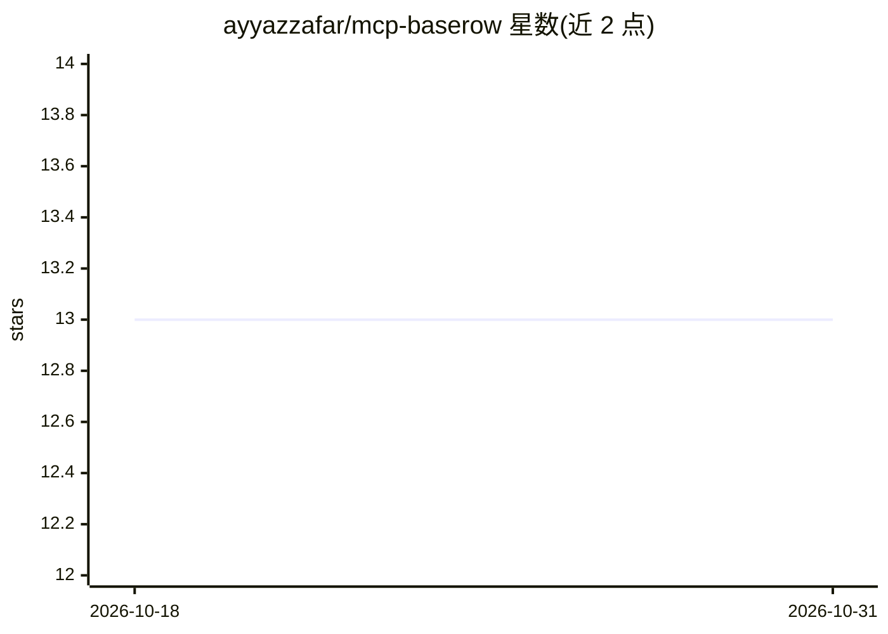

# ayyazzafar/mcp-baserow

⭐ 13 · TypeScript · MIT · 推送 2026-06-12 · [GitHub](https://github.com/ayyazzafar/mcp-baserow) · 个人维护

**让 AI 助手用自然语言操作 Baserow 数据库的 MCP 服务器**

基于 TypeScript/Node.js 的 Model Context Protocol 服务器，将 Baserow 的 API 封装为 MCP 工具集，供 Claude Desktop、Cursor、Windsurf 等 MCP 客户端通过自然语言执行数据库操作。提供 21 个工具，覆盖认证（用户名密码自动刷新令牌/JWT/数据库令牌三种方式）、工作区、数据库、表管理与行级 CRUD 及批量操作，支持分页/过滤/排序查询。安装方式为 git clone 源码 + npm 构建，需 Node.js v22+ 与 Baserow 账号（自托管或云）。

## 筛选速览

| 维度 | 判定 | 备注 |
|---|---|---|
| AI 角色 | `ai-ecosystem` | LLM/agent 周边工具 |
| 许可风险 | `permissive` | MIT |
| 部署形态 | `library` | 以包/库形式分发 |
| 模型依赖 | — | README 未给出锁定关系 |
| 硬件要求 | — | 无带数字的原话,不猜 |
| 安装摩擦 | `low` | 无编译、无系统依赖或容器化 |
| 成熟度 | — | 结构信号不足 |

## 能力要点

- 21 个 MCP 工具：认证 3 + 工作区 4 + 数据库 3 + 表 3 + 行操作 8
- 三种认证方式：凭据自动刷新令牌 / JWT（60 分钟）/ 数据库令牌（不过期）
- 支持自托管 Baserow 实例的 API URL 覆盖
- 支持 Claude Desktop / Cursor / Windsurf 客户端配置

## 适用场景

- 在 Claude Desktop 或 Cursor 中用自然语言管理 Baserow 数据库
- 通过对话批量创建、更新、删除数据表行
- 对自托管 Baserow 实例做自然语言查询与筛选

## 场景标签

 · 领域:AI 工具集成/数据库

## 证据(README 行号)

> L8: An MCP (Model Context Protocol) server that provides seamless integration between MCP-compatible clients (Claude Des
> L144: ### Available MCP Tools

## 星数曲线

2026-10-18 13 → 2026-10-31 13（+0）

---
*卡片 v1 · prompt 1.4 · 生成 2026-10-31 · 置信度 high · 依据 README sha `8b514213f24e` · [字段定义](../../DATASET.md)*
