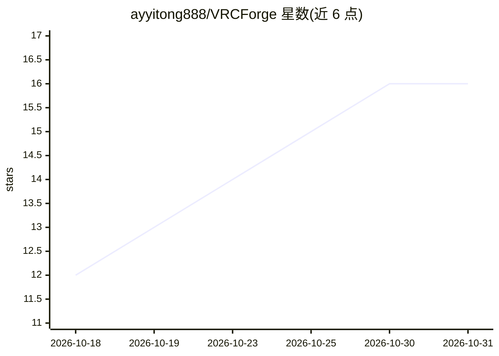

# ayyitong888/VRCForge

⭐ 16 · Python · GPL-3.0 · 推送 2026-10-30 · [GitHub](https://github.com/ayyitong888/VRCForge) · [官网](https://ayyitong888.github.io/VRCForge/) · 个人维护 · 中文 README

**面向 VRChat Avatar 创作者的 AI 辅助改模工具与 Unity MCP 服务器**

给 VRChat Avatar 创作者使用的开源改模工具：通过自然语言让内置 AI 助手或外部 MCP 客户端查看 Unity 工程、规划并实际应用修改，覆盖捏脸（BlendShape）、换装衣柜、材质/着色器编辑、换装动画、部件移植与贴图优化诊断。对 Unity 资产写入采用“读取→规划→确认→执行→读回→恢复”的受监督流程，支持逐项确认与自动权限模式。产品由 Windows App 安装包与 Unity Core 插件（.unitypackage）两部分组成，两者须配套安装；限定 Windows x64、Unity 2022.3 LTS 与 VRChat SDK3 Avatar 工程。

## 筛选速览

| 维度 | 判定 | 备注 |
|---|---|---|
| AI 角色 | `ai-enhanced` | 去掉 AI 部分产品仍成立 |
| 许可风险 | `viral` | GPL-3.0 |
| 部署形态 | `desktop` | 安装包/桌面程序 |
| 模型依赖 | — | README 未给出锁定关系 |
| 硬件要求 | — | 无带数字的原话,不猜 |
| 安装摩擦 | `low` | 无编译、无系统依赖或容器化 |
| 成熟度 | `idea` | |

## 能力要点

- 自然语言驱动的 Avatar 修改：捏脸、换装、材质、动画、部件移植
- Unity 资产写入采用读取→规划→确认→执行→读回→恢复的受监督流程，含检查点恢复
- 同时提供内置 Agent 与外部 MCP 客户端接入（本地 MCP + REST 网关）
- 贴图/部件资源占用诊断与优化建议，支持 .vsk 技能包导入导出

## 适用场景

- 用自然语言调整 Avatar 的脸型、表情和身材并实时预览
- 给模型换装、整理衣柜菜单并制作换装动画
- 诊断并优化 Avatar 贴图与部件的资源占用
- 通过 MCP 让 Codex、Claude Code 等外部 AI 客户端操作 Unity 工程

## 场景标签

`AI 助手` · 领域:对话与助手

## 证据(README 行号)

> L17: VRCForge 是给 VRChat Avatar 创作者使用的开源改模工具。你可以用自然语言说出想改的
> L18: 脸型、衣服、材质或动画，让助手查看工程、提出修改并实际应用。
> L53: |选择顺手的 AI|填入 API Key 使用内置 AI，或通过 MCP 连接你常用的 AI 助手。你可以选择逐步确认，也可以允许它自动操作。|

## 星数曲线

2026-10-18 12 → 2026-10-31 16（+4）

---
*卡片 v1 · prompt 1.4 · 生成 2026-10-30 · 置信度 mid · 依据 README sha `b3d0e82c3432` · [字段定义](../../DATASET.md)*
