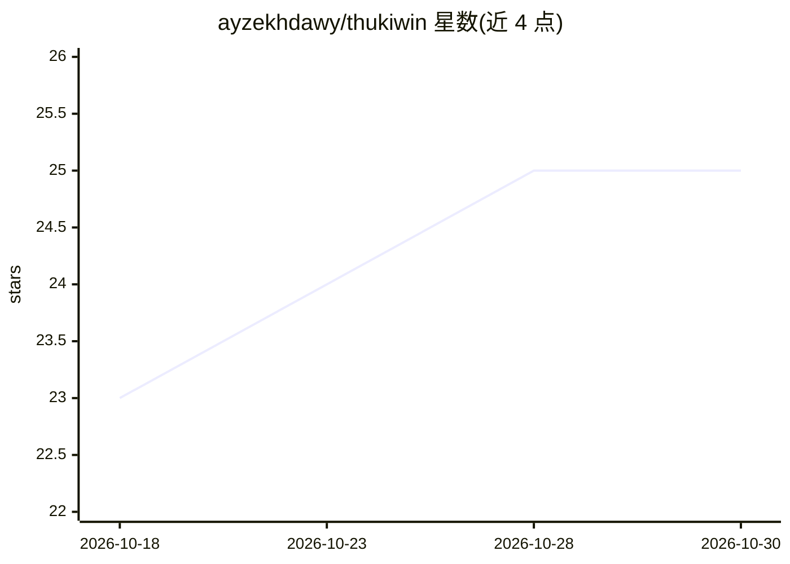

# ayzekhdawy/thukiwin

⭐ 25 · Rust · NOASSERTION · 推送 2026-08-29 · [GitHub](https://github.com/ayzekhdawy/thukiwin) · 个人维护

**Windows 本地悬浮 AI 助手：双击 Ctrl 随处唤起问答与桌面代理**

基于 Tauri v2 + React + Rust 的 Windows 悬浮覆盖层应用，双击 Ctrl 在任意应用（含全屏）中唤起，支持划词引用、屏幕截图作上下文、图像输入和 /do /screen /translate 等 slash 命令。默认经本地 Ollama 运行模型，也可选接 OpenAI/Anthropic 做工具调用的桌面代理模式，由模型返回动作并通过 Win32 SendInput 控制桌面。对话存于本地 SQLite，无遥测；代理模式有 30 次迭代上限与危险动作确认机制。提供安装包下载与源码构建两种途径。

## 筛选速览

| 维度 | 判定 | 备注 |
|---|---|---|
| AI 角色 | `ai-native` | 本体是模型或模型工具 |
| 许可风险 | `none` | NOASSERTION |
| 部署形态 | `desktop` | 安装包/桌面程序 |
| 模型依赖 | local-ok | 支持本地模型 |
| 硬件要求 | — | 无带数字的原话,不猜 |
| 安装摩擦 | `low` | 无编译、无系统依赖或容器化 |
| 成熟度 | `idea` | |

## 能力要点

- 双击 Ctrl 全局唤起悬浮窗，划词引用与截图作上下文
- /do 代理模式：视觉模型驱动的桌面自动操作（点击/输入/启动应用）
- 默认 Ollama 本地推理，可选 OpenAI/Anthropic 云 API 工具调用
- 内置 9 个 slash 命令与 Edge TTS 语音朗读

## 适用场景

- 不离开当前工作的情况下快速向 AI 提问
- 让 AI 读取屏幕内容并代为完成桌面操作
- 本地运行 LLM 进行零成本、无遥测的日常问答

## 场景标签

`AI 助手` `GUI 自动化` · 领域:效率与自动化

## 证据(README 行号)

> L25: ThukiWin is a lightweight Windows overlay powered by AI — fully local via Ollama, or connect to OpenAI/Anthropic fo
> L31: Double-tap Ctrl to summon ThukiWin from anywhere. Ask a question, get an answer, and dismiss. Use `/screen` or the 

## 星数曲线

2026-10-18 23 → 2026-10-30 25（+2）

---
*卡片 v1 · prompt 1.4 · 生成 2026-10-27 · 置信度 high · 依据 README sha `651083b5c356` · [字段定义](../../DATASET.md)*
