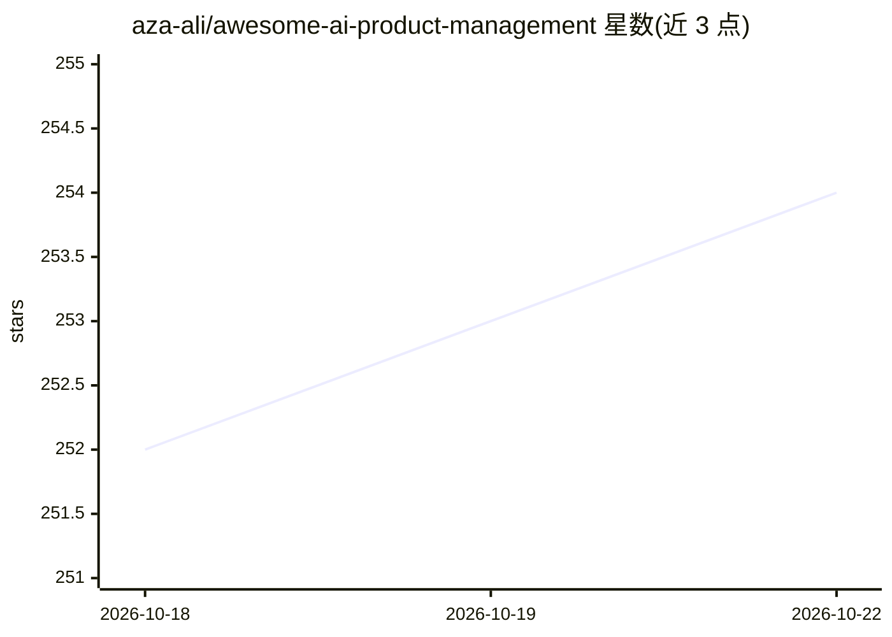

# aza-ali/awesome-ai-product-management

⭐ 254 · 推送 2026-05-24 · [GitHub](https://github.com/aza-ali/awesome-ai-product-management) · [官网](https://github.com/aza-ali/awesome-ai-product-management) · 个人维护

**AI 产品经理资源策展清单：工具、框架、书单与报告**

面向产品经理（PM）的精选资源清单，围绕如何用 AI 提升产品工作展开。内容分节收录：PM 日常使用的 AI 工具（Claude、NotebookLM、Perplexity、Cursor 等）、AI 产品思维框架与文章、通讯与博客、书籍、播客、行业研究报告（a16z、Sequoia、Stanford AI Index 等）以及可关注的从业者账号。条目为纯链接与简介，无代码、无安装步骤，许可证为 CC0。

## 筛选速览

| 维度 | 判定 | 备注 |
|---|---|---|
| AI 角色 | `ai-knowledge` | 知识聚合/清单类 |
| 许可风险 | `none` | — |
| 部署形态 | `None` |  |
| 模型依赖 | — | README 未给出锁定关系 |
| 硬件要求 | — | 无带数字的原话,不猜 |
| 安装摩擦 | `low` | 无编译、无系统依赖或容器化 |
| 成熟度 | — | 结构信号不足 |

## 能力要点

- 按研究、原型、文档、用户反馈等场景分类收录 PM 用 AI 工具
- 收录 AI 产品思维框架文章与行业研究报告
- 包含书籍、播客、通讯与可关注人物清单

## 适用场景

- 作为 PM 查找日常 AI 工具与研究资料
- 了解 AI 产品管理的框架与行业报告
- 发现相关书籍、播客与关注账号

## 场景标签

 · 领域:产品管理/知识聚合

## 证据(README 行号)

> L3: > A curated list for product managers.
> L9: ## Tools for PMs

## 星数曲线

2026-10-18 252 → 2026-10-22 254（+2）

---
*卡片 v1 · prompt 1.4 · 生成 2026-10-22 · 置信度 high · 依据 README sha `4cc10ecd19fe` · [字段定义](../../DATASET.md)*
