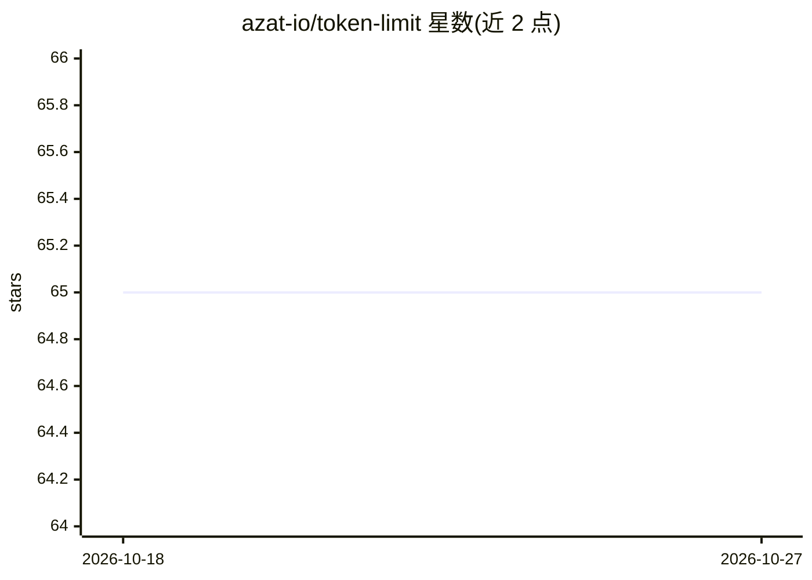

# azat-io/token-limit

⭐ 65 · TypeScript · MIT · 推送 2026-04-26 · [GitHub](https://github.com/azat-io/token-limit) · 个人维护

**监控代码与配置文件 token 消耗并设置预算告警的 CLI 工具**

面向使用 AI 上下文文件（CLAUDE.md、.cursorrules 等）的开发者：通过各模型官方 tokenizer（tiktoken、Anthropic）计算文件真实 token 数，支持按 token 或美元成本设置预算，超限时报告明细并可使 CI 构建失败。支持 OpenAI GPT 与 Anthropic Claude 多模型，定价数据来自 OpenRouter API 而非硬编码。以 npm 包与 npx 命令行方式提供，可集成 GitHub Actions。

## 筛选速览

| 维度 | 判定 | 备注 |
|---|---|---|
| AI 角色 | `ai-ecosystem` | LLM/agent 周边工具 |
| 许可风险 | `permissive` | MIT |
| 部署形态 | `library` | 以包/库形式分发 |
| 模型依赖 | locked-api |  |
| 硬件要求 | — | 无带数字的原话,不猜 |
| 安装摩擦 | `low` | 无编译、无系统依赖或容器化 |
| 成熟度 | — | 结构信号不足 |

## 能力要点

- 使用官方 tokenizer（tiktoken/Anthropic）计算真实 token 数
- 支持 token 数与美元成本双维度预算限制
- CI 集成：超预算时构建失败，拦截 PR 中的超限变更
- 定价数据从 OpenRouter API 获取，支持多种配置文件格式

## 适用场景

- 防止仓库中的 AI 指令文件膨胀导致上下文窗口溢出
- 在 CI 中拦截使 token 预算超限的 PR
- 预估 AI 上下文文件的 API 调用成本

## 场景标签

`LLM 可观测性` · 领域:评测与运维

## 证据(README 行号)

> L14: Token Limit helps you monitor how many tokens your AI context files consume. Set token budgets for your prompts, do
> L52: 2. **Analyze** files using official tokenizers for each AI model (tiktoken, Anthropic)

## 星数曲线

2026-10-18 65 → 2026-10-27 65（+0）

---
*卡片 v1 · prompt 1.4 · 生成 2026-10-24 · 置信度 high · 依据 README sha `fe8da87c7ba3` · [字段定义](../../DATASET.md)*
