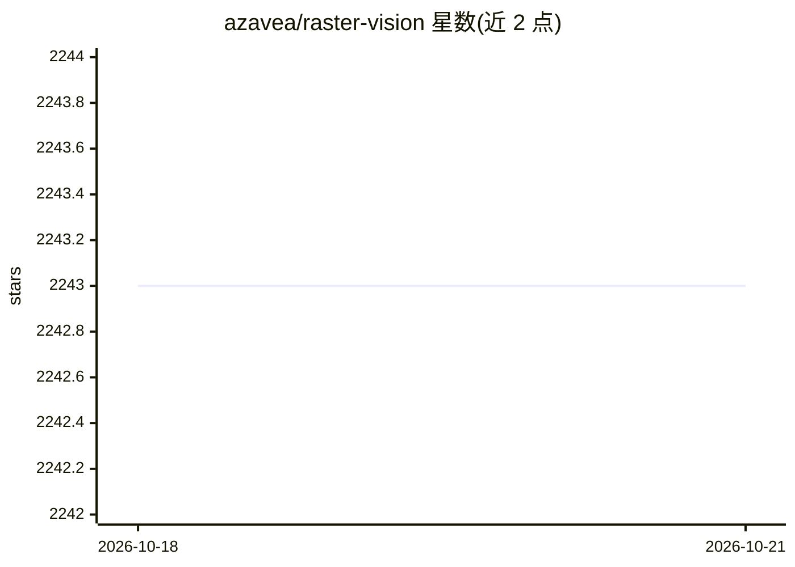

# azavea/raster-vision

⭐ 2,243 · Python · Apache-2.0 · 推送 2026-06-04 · [GitHub](https://github.com/azavea/raster-vision) · [官网](https://docs.rastervision.io) · 组织维护

**面向卫星/航空影像的深度学习库与低代码框架**

Python 库与框架，用于在卫星、航空及无人机等大型影像集上构建计算机视觉模型，内置 chip 分类、目标检测与语义分割能力，后端基于 PyTorch。作为库，提供读取地理参考数据、训练模型、预测并按地理参考格式输出等工具；作为低代码框架，用户通过配置少量参数即可执行含数据分析、切片、训练、预测、评估与打包部署的机器学习流水线。支持通过 AWS Batch 与 AWS SageMaker 在云端运行实验。

## 筛选速览

| 维度 | 判定 | 备注 |
|---|---|---|
| AI 角色 | `ai-native` | 本体是模型或模型工具 |
| 许可风险 | `permissive` | Apache-2.0 |
| 部署形态 | `library` | 以包/库形式分发 |
| 模型依赖 | — | README 未给出锁定关系 |
| 硬件要求 | — | 无带数字的原话,不猜 |
| 安装摩擦 | `low` | 无编译、无系统依赖或容器化 |
| 成熟度 | — | 结构信号不足 |

## 能力要点

- chip 分类、目标检测、语义分割三种任务内置支持，PyTorch 后端
- 低代码方式配置完整机器学习流水线（数据切片→训练→预测→评估→打包）
- 支持 AWS Batch 与 AWS SageMaker 云端运行实验

## 适用场景

- 对卫星或航空影像做语义分割/目标检测模型训练
- 不深入深度学习细节、以配置参数方式跑通地学 CV 流水线
- 将预测结果以地理参考格式写出并部署模型

## 场景标签

`目标检测` `模型训练` · 领域:感知与多模态

## 证据(README 行号)

> L10: Raster Vision is an open source Python **library** and **framework** for building computer vision models on satelli
> L12: It has built-in support for chip classification, object detection, and semantic segmentation with backends using Py

## 星数曲线

2026-10-18 2,243 → 2026-10-21 2,243（+0）

---
*卡片 v1 · prompt 1.4 · 生成 2026-10-21 · 置信度 high · 依据 README sha `928fc72cccbc` · [字段定义](../../DATASET.md)*
