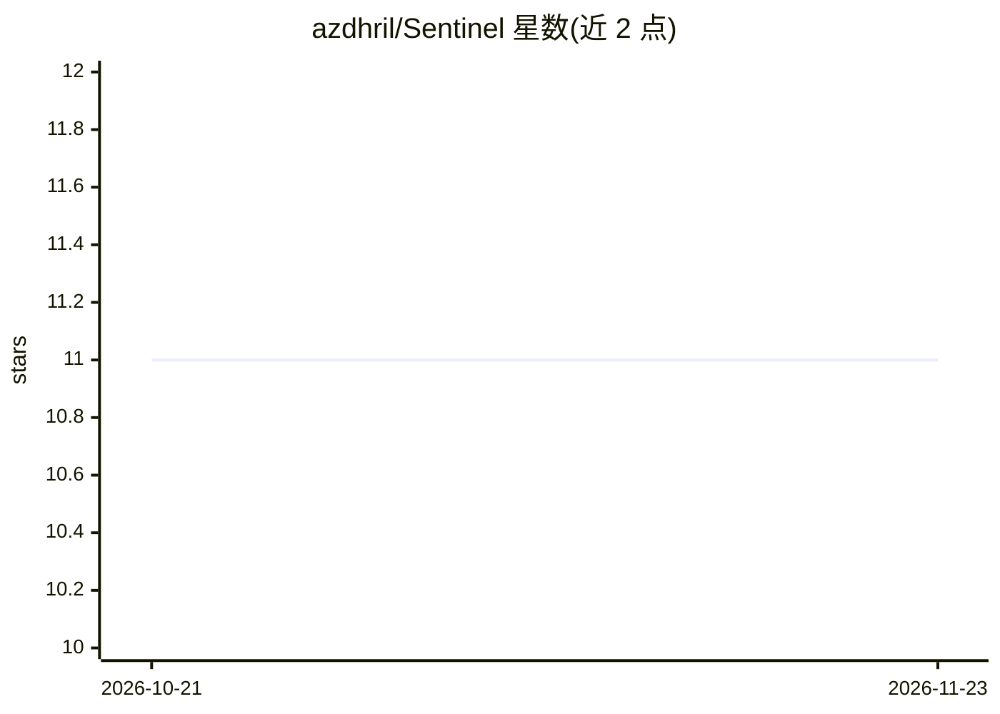

# azdhril/Sentinel

⭐ 11 · Python · MIT · 推送 2026-01-25 · [GitHub](https://github.com/azdhril/Sentinel) · [官网](https://pypi.org/project/agentic-sentinel/) · 个人维护

**给 AI Agent 加人工审批与审计的零信任治理中间件**

Python 中间件库，通过装饰器拦截 AI Agent 对工具的调用，按 JSON 规则对高风险动作（转账、发邮件、删记录等）强制人工审批，支持终端、Webhook、Streamlit 仪表盘三种审批通道，并输出 JSONL 审计日志。内置统计异常检测（Z-Score）与默认 fail-secure 行为，出错时阻断而非放行。提供 protect_tools() 封装 LangChain 工具，架构图显示兼容 CrewAI、AutoGPT 等框架。

## 筛选速览

| 维度 | 判定 | 备注 |
|---|---|---|
| AI 角色 | `ai-ecosystem` | LLM/agent 周边工具 |
| 许可风险 | `permissive` | MIT |
| 部署形态 | `library` | 以包/库形式分发 |
| 模型依赖 | — | README 未给出锁定关系 |
| 硬件要求 | — | 无带数字的原话,不猜 |
| 安装摩擦 | `low` | 无编译、无系统依赖或容器化 |
| 成熟度 | `idea` | |

## 能力要点

- 一个装饰器为 Agent 工具调用接入规则引擎与人工审批
- 多通道审批：终端、Webhook、Streamlit 仪表盘
- JSONL 审计日志与统计异常检测（Z-Score 自动阻断）
- 默认 fail-secure：出错即阻断动作

## 适用场景

- 金融场景对超过阈值的 Agent 交易操作要求人工确认
- 运维场景对生产环境部署操作加审批闸门
- 为 Agent 动作留存可合规审计的日志

## 场景标签

`LLM 可观测性` · 领域:评测与运维

## 证据(README 行号)

> L3: **Zero-trust governance for AI agents. One decorator. Full control.**
> L53: |🔗 **LangChain Native**|`protect_tools()` wraps any LangChain tool|

## 星数曲线

2026-10-21 11 → 2026-11-23 11（+0）

---
*卡片 v1 · prompt 1.4 · 生成 2026-11-18 · 置信度 high · 依据 README sha `466f341507c0` · [字段定义](../../DATASET.md)*
