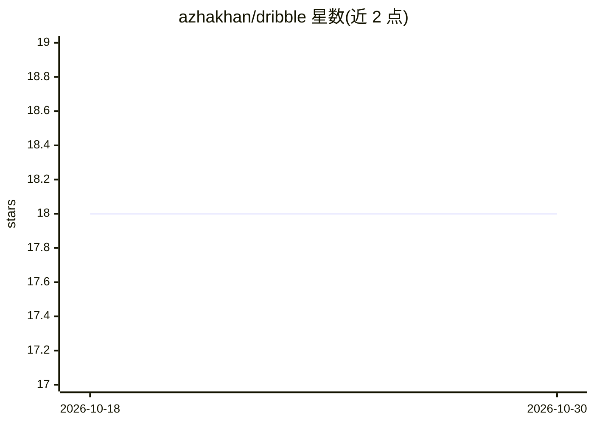

# azhakhan/dribble

⭐ 18 · TypeScript · MIT · 推送 2026-09-24 · [GitHub](https://github.com/azhakhan/dribble) · [官网](https://dribblesql.com) · 个人维护

**带 AI 数据分析员的 Web 端开源 SQL IDE**

基于 Next.js 的 Web SQL IDE：连接 Postgres 数据库，提供 Monaco 编辑器中的 SQL 笔记本、可折叠的 schema 浏览器、带服务端分页与 WHERE 过滤的表浏览、虚拟化结果网格；内置 AI 数据分析员（Claude Opus 4.8），可检视 schema、生成并运行只读 SQL、迭代修正错误并渲染结果表。支持无登录本地使用或 Google 登录多用户部署，连接凭据加密存储。需 Node.js 20+、元数据用 Postgres 与 Anthropic API key，目前仅 Postgres 驱动。

## 筛选速览

| 维度 | 判定 | 备注 |
|---|---|---|
| AI 角色 | `ai-native` | 本体是模型或模型工具 |
| 许可风险 | `permissive` | MIT |
| 部署形态 | `library` | 以包/库形式分发 |
| 模型依赖 | locked-api |  |
| 硬件要求 | — | 无带数字的原话,不猜 |
| 安装摩擦 | `low` | 无编译、无系统依赖或容器化 |
| 成熟度 | `idea` | |

## 能力要点

- AI agent 检视 schema、生成运行只读 SQL 并迭代修正错误
- SQL 笔记本（Monaco）与 schema 浏览器、表浏览器
- 持久化工作区：标签页、布局与缓存结果跨浏览器保留
- 无登录本地运行或 Google OAuth 多用户模式，凭据加密存储

## 适用场景

- 在浏览器里写 SQL、浏览表结构和数据
- 用自然语言向 AI 提问并得到查询结果
- 多用户团队部署，各自保留私有的连接与笔记本

## 场景标签

`数据分析` · 领域:效率与自动化

## 证据(README 行号)

> L7: Dribble is a web-based SQL IDE with a built-in AI data analyst. Connect to a
> L14: - **AI data analyst** — chat with an agent (Claude Opus 4.8) that inspects your
> L15:  schema, writes and runs read-only SQL, iterates on errors, and renders the

## 星数曲线

2026-10-18 18 → 2026-10-30 18（+0）

---
*卡片 v1 · prompt 1.4 · 生成 2026-10-29 · 置信度 high · 依据 README sha `958c2862bcf1` · [字段定义](../../DATASET.md)*
