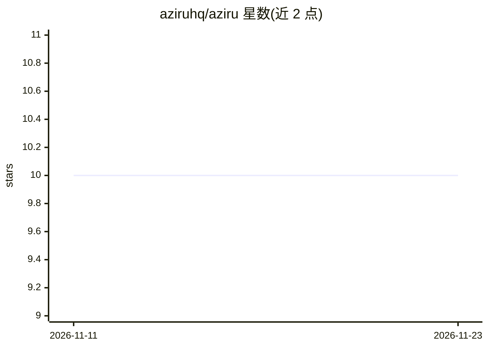

# aziruhq/aziru

⭐ 10 · TypeScript · AGPL-3.0 · 推送 2026-10-06 · [GitHub](https://github.com/aziruhq/aziru) · [官网](https://amarnai.com) · 组织维护

**自托管的 Gmail AI 邮件分拣助手：分类收件箱、草稿需人工批准**

开源、可自托管的邮件分拣助手：将收件箱按用户自定义的分类体系（taxonomy）整理并打标签。Gmail 为默认接入方式（仅 gmail.readonly 只读权限），Outlook 经 Microsoft Graph 提供只读支持（beta）。生成草稿一律需要用户批准，不会自动发送或修改邮件。支持 Ollama 本地推理与 Gemini/OpenAI 等 OpenAI 兼容端点；通过 Docker Compose 一条命令启动 web/API/worker/Postgres/Redis 全部服务，可选用 Pub/Sub 实现实时推送，默认 5 分钟轮询。

## 筛选速览

| 维度 | 判定 | 备注 |
|---|---|---|
| AI 角色 | `ai-native` | 本体是模型或模型工具 |
| 许可风险 | `viral` | AGPL-3.0 |
| 部署形态 | `self-host` | docker 或自建部署 |
| 模型依赖 | local-ok | 支持本地模型 |
| 硬件要求 | — | 无带数字的原话,不猜 |
| 安装摩擦 | `low` | 无编译、无系统依赖或容器化 |
| 成熟度 | — | 结构信号不足 |

## 能力要点

- 只读连接：排序与打标签，不发信不改信，草稿须批准
- 接入方式可选本地 Ollama 或 Gemini/OpenAI 兼容端点
- Gmail 实时推送（Pub/Sub）与 5 分钟轮询双模式
- Docker Compose 一键自托管，含 Postgres/Redis

## 适用场景

- 用自定义分类体系自动整理 Gmail 收件箱
- 在本地或自有服务器上自托管邮件整理工具
- 让 AI 起草回复草稿但保留人工审批

## 场景标签

`工作流自动化` · 领域:效率与自动化

## 证据(README 行号)

> L3: Gmail-first AI email triage assistant, with read-only Outlook support in beta. Both connections are read-only: Aziru
> L53: The recommended production configuration is Gemini for both the LLM (via its OpenAI-compatible endpoint) and embedd

## 星数曲线

2026-11-11 10 → 2026-11-23 10（+0）

---
*卡片 v1 · prompt 1.4 · 生成 2026-11-19 · 置信度 mid · 依据 README sha `a789006dfbd4` · [字段定义](../../DATASET.md)*
