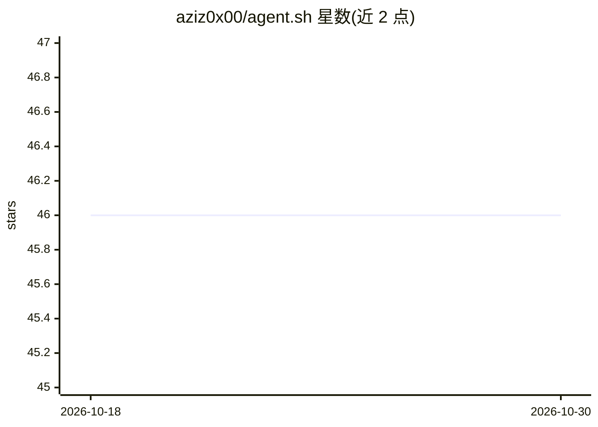

# aziz0x00/agent.sh

⭐ 46 · Shell · MIT · 推送 2026-07-09 · [GitHub](https://github.com/aziz0x00/agent.sh) · 个人维护

**用 Bash 编写的极简终端 agent 客户端**

以简单与可组合为目标编写的终端 agent 工具：通过 chat 命令与模型对话，支持管道输入、--raw 单次输出与 --free 跳过权限提示。内置 Glob/Grep/Read/Edit/Write/Bash 等工具及 Exa AI 联网搜索，提供 /state、/model 等斜杠命令，可从 providers/ 目录选择提供商（默认 opencode-go，可切换 Ollama）。技能按 SKILL.md 格式放置于 ~/.agents/skills/，工具即 Bash 函数，可自行扩展。安装需先备好 uv、jq、rg 等依赖并克隆仓库设置别名。

## 筛选速览

| 维度 | 判定 | 备注 |
|---|---|---|
| AI 角色 | `ai-ecosystem` | LLM/agent 周边工具 |
| 许可风险 | `permissive` | MIT |
| 部署形态 | `None` |  |
| 模型依赖 | local-ok | 支持本地模型 |
| 硬件要求 | — | 无带数字的原话,不猜 |
| 安装摩擦 | `low` | 无编译、无系统依赖或容器化 |
| 成熟度 | — | 结构信号不足 |

## 能力要点

- 管道式输入输出（cmd | chat --raw > out.md）
- 内置 9 类工具：文件读写编辑、Bash、WebSearch（Exa AI）、Skill 等
- 通过 PROVIDER 环境变量切换提供商（如 Ollama）
- 工具即 Bash 函数，技能兼容 SKILL.md 格式，可扩展

## 适用场景

- 在终端里以命令行方式与 LLM 对话并执行任务
- 把命令输出管道给模型做总结或分析
- 用本地 Ollama 模型运行终端 agent

## 场景标签

`AI 助手` · 领域:对话与助手

## 证据(README 行号)

> L3: tiny terminal agent, written with simplicity and composability in mind.
> L38: Pick a provider from `providers/` with the `PROVIDER` env var (default: `opencode-go`)

## 星数曲线

2026-10-18 46 → 2026-10-30 46（+0）

---
*卡片 v1 · prompt 1.4 · 生成 2026-10-25 · 置信度 high · 依据 README sha `962f8eaf0fe0` · [字段定义](../../DATASET.md)*
