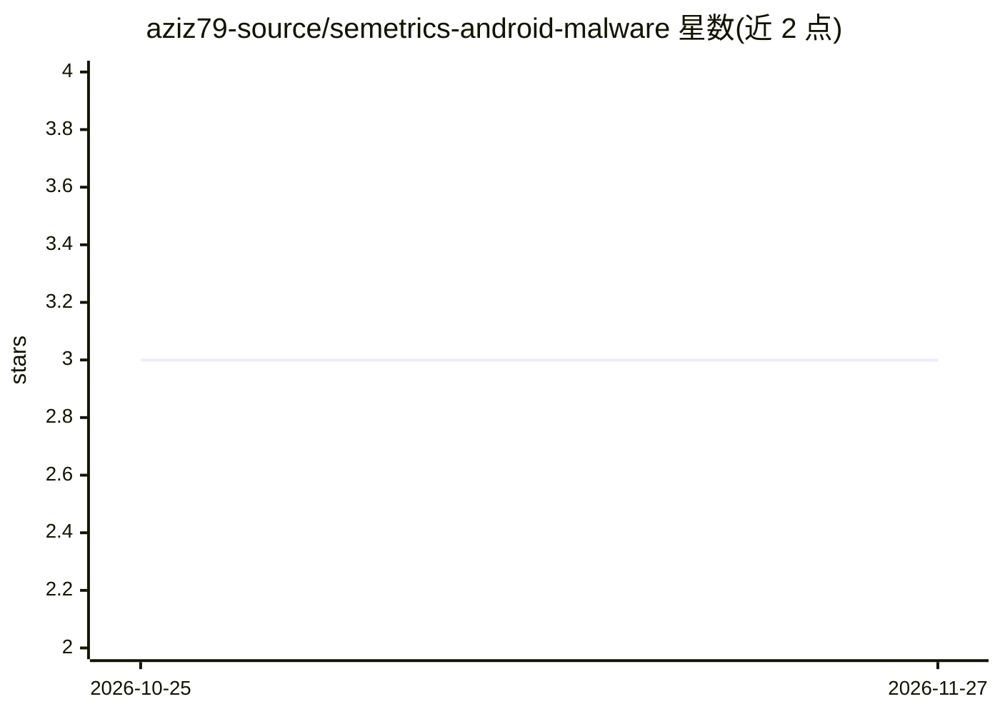

# aziz79-source/semetrics-android-malware

⭐ 3 · Python · 推送 2026-10-24 · [GitHub](https://github.com/aziz79-source/semetrics-android-malware) · 组织维护

**课程项目：用静态软件工程度量与 ML 分类 Android 恶意应用**

ISEC 363 课程项目，不运行 APK，仅通过静态分析提取方法级软件工程度量（LOC、控制流复杂度、fan-in/fan-out、分支与调用数、可见性等 11 项），汇总为 8 种统计量构成 90 列特征向量，训练 6 种 scikit-learn 分类器区分良性应用与广告软件（205 个应用样本）。可只用附带的 CSV 复现分类与图表；完整流水线需仓库外部的 Java 8、Soot、FlowDroid 与 DroidASAT 工具。作者自述测试集小、恶意样本仅单一 adware 类别等局限。

## 筛选速览

| 维度 | 判定 | 备注 |
|---|---|---|
| AI 角色 | `ai-native` | 本体是模型或模型工具 |
| 许可风险 | `none` | — |
| 部署形态 | `library` | 以包/库形式分发 |
| 模型依赖 | — | README 未给出锁定关系 |
| 硬件要求 | — | 无带数字的原话,不猜 |
| 安装摩擦 | `medium` | 含编译或系统依赖之一 |
| 成熟度 | — | 结构信号不足 |

## 能力要点

- 静态提取 11 项方法级度量并汇总为 8 种统计量，无需运行 APK
- 6 种分类器对比评估，含 80/20 划分与 Random Forest 10 折交叉验证结果
- 附带 205 应用、90 列的标注数据集 CSV
- 提供仅分类与完整流水线两种运行方式

## 适用场景

- 复现基于静态度量的 Android 恶意软件分类实验
- 在不执行不可信 APK 的情况下批量提取应用特征
- 作为软件度量与机器学习课程的教学参考实现

## 场景标签

`网络安全` · 领域:学习与行业

## 证据(README 行号)

> L7: This project detects Android malware without running or dynamically analyzing the apps. Instead, it statically extra
> L20: `DroidASAT` (not included in this repository) is a static analysis tool built on Soot and FlowDroid. It walks each 
> L97: Originally developed as a course project for Secure Software Development (ISEC 363), University of Ha'il, 2026.

## 星数曲线

2026-10-25 3 → 2026-11-27 3（+0）

---
*卡片 v1 · prompt 1.4 · 生成 2026-11-22 · 置信度 high · 依据 README sha `c805cf4004c6` · [字段定义](../../DATASET.md)*
