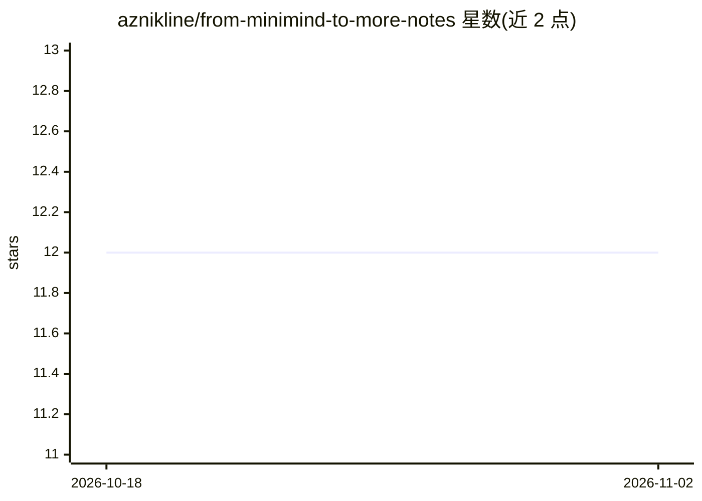

# aznikline/from-minimind-to-more-notes

⭐ 12 · NOASSERTION · 推送 2026-08-06 · [GitHub](https://github.com/aznikline/from-minimind-to-more-notes) · 个人维护 · 中文 README

**大模型教学项目的逐篇精读笔记（17篇，含面试考点）**

对 Tongyun1/from-minimind-to-more 全 17 篇正文（约 62 万字）的逐篇结构化精读合成笔记，覆盖基石、架构、算法、求职四篇，主题包括 Tokenizer、KV Cache、Flash Attention、MoE、RLHF 算法（SFT/DPO/PPO/GRPO）等。每篇笔记含固定八段结构：一句话精炼、核心概念、LaTeX 公式、伪代码、对照 minimind 源码要点、面试考点、批判性批注与思维导图。仅含笔记不含原正文，附四类角色阅读路径。

## 筛选速览

| 维度 | 判定 | 备注 |
|---|---|---|
| AI 角色 | `ai-knowledge` | 知识聚合/清单类 |
| 许可风险 | `none` | NOASSERTION |
| 部署形态 | `None` |  |
| 模型依赖 | — | README 未给出锁定关系 |
| 硬件要求 | — | 无带数字的原话,不猜 |
| 安装摩擦 | `low` | 无编译、无系统依赖或容器化 |
| 成熟度 | — | 结构信号不足 |

## 能力要点

- 17 篇逐篇精读笔记，覆盖基石/架构/算法/求职四类主题
- 每篇固定结构：概念、公式、伪代码、源码对照、面试考点、批判性批注
- 总览文件含 GRPO 家族谱系、训练链路图与工程速查表
- 提供新手/求职/算法岗/工程岗四条阅读路径

## 适用场景

- 系统学习 LLM 训练全链路（预训练到 RLHF）的教学笔记
- 准备大模型算法岗面试，按求职路径复习八股与考点
- 了解 minimind 极简实现与工业标准的差异点

## 场景标签

`教程课程` · 领域:学习与行业

## 证据(README 行号)

> L3: > 对 Tongyun1/from-minimind-to-more 全 17 篇正文(约 62 万字 / 1 万行)的逐篇精读合成笔记。
> L9: 一份对 `from-minimind-to-more` 仓库的**逐篇结构化精读笔记**,覆盖:

## 星数曲线

2026-10-18 12 → 2026-11-02 12（+0）

---
*卡片 v1 · prompt 1.4 · 生成 2026-11-01 · 置信度 high · 依据 README sha `6d995ef9f84a` · [字段定义](../../DATASET.md)*
