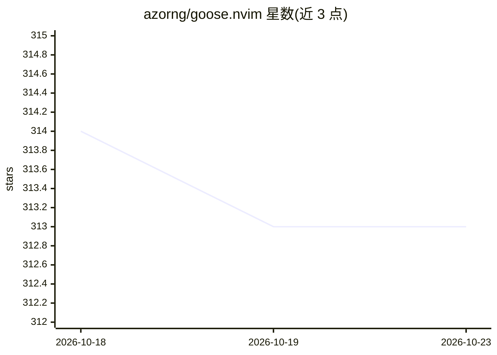

# azorng/goose.nvim

⭐ 313 · Lua · Apache-2.0 · 推送 2026-08-26 · [GitHub](https://github.com/azorng/goose.nvim) · 个人维护

**Neovim 插件：在编辑器内接入 goose AI agent 对话**

在 Neovim 与 goose AI agent（Block 开发）之间提供桥接的 Lua 插件：以聊天界面调用 goose，自动捕获当前文件、选中文本、@提及文件与诊断信息作为上下文，维护与工作区绑定的持久会话。提供约 25 个动作（键位/命令/Lua API），支持 chat/auto/approve 等 goose 模式切换、diff 查看与文件改动回滚、斜杠命令与技能的 omnifunc 补全。要求先安装 goose CLI 并配置 LLM provider，可配置 fzf-lua/telescope/mini.pick/snacks 选择器与 blink.cmp 补全插件。

## 筛选速览

| 维度 | 判定 | 备注 |
|---|---|---|
| AI 角色 | `ai-ecosystem` | LLM/agent 周边工具 |
| 许可风险 | `permissive` | Apache-2.0 |
| 部署形态 | `None` |  |
| 模型依赖 | — | README 未给出锁定关系 |
| 硬件要求 | — | 无带数字的原话,不猜 |
| 安装摩擦 | `low` | 无编译、无系统依赖或容器化 |
| 成熟度 | — | 结构信号不足 |

## 能力要点

- 自动捕获当前文件/选区/提及文件/诊断作为对话上下文
- 工作区绑定的持久会话与多会话切换
- diff 查看、逐文件/全部回滚 goose 产生的改动
- 斜杠命令与技能（#）的 neovim 原生 omnifunc 补全

## 适用场景

- 在 Neovim 内与 goose AI agent 对话而不切换工具
- 让 agent 基于当前文件与选区进行代码操作并审查/回滚 diff
- 通过 @文件 与 #技能 给 agent 补充上下文

## 场景标签

`编码 Agent` · 领域:编码与开发

## 证据(README 行号)

> L11: This plugin provides a bridge between neovim and the goose AI agent, creating a chat interface while capturing edit
> L21: - Goose CLI installed and available (see Setting up goose below)

## 星数曲线

2026-10-18 314 → 2026-10-23 313（-1）

---
*卡片 v1 · prompt 1.4 · 生成 2026-10-21 · 置信度 high · 依据 README sha `aafca68324ad` · [字段定义](../../DATASET.md)*
