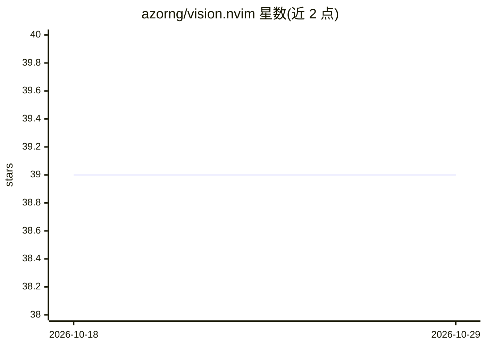

# azorng/vision.nvim

⭐ 39 · Lua · Apache-2.0 · 推送 2026-05-25 · [GitHub](https://github.com/azorng/vision.nvim) · 个人维护

**Neovim 插件：Visual 模式下向 AI agent 自动附带编辑器上下文**

面向 Neovim 用户的 Lua 插件，通过 Visual 模式选取内容作为编辑器与 AI agent 之间的桥梁：提交 prompt 时，visionctl 命令行桥接工具连接对应 Neovim 会话，捕获选区、当前文件、光标、诊断等上下文，渲染为 provider 特定格式随 prompt 一同交给 agent。支持 Codex、Claude、Cursor、OpenCode、Pi 五种 agent，通过 :VisionInstall 命令修改各 agent 配置文件安装钩子。仅 Visual 模式提交时附带上下文，否则不附带。

## 筛选速览

| 维度 | 判定 | 备注 |
|---|---|---|
| AI 角色 | `ai-ecosystem` | LLM/agent 周边工具 |
| 许可风险 | `permissive` | Apache-2.0 |
| 部署形态 | `None` |  |
| 模型依赖 | — | README 未给出锁定关系 |
| 硬件要求 | — | 无带数字的原话,不猜 |
| 安装摩擦 | `low` | 无编译、无系统依赖或容器化 |
| 成熟度 | — | 结构信号不足 |

## 能力要点

- Visual 模式选取即自动附带编辑器上下文给 agent
- 支持 Codex / Claude / Cursor / OpenCode / Pi 五种 provider 集成
- visionctl 短生命期 CLI 通过 socket/TCP 会话发现连接 Neovim 进程
- 通过 lazy.nvim 或 vim.pack（Neovim 0.12+）安装

## 适用场景

- 在 Neovim 中选中文本后直接向 Claude/Codex 等 coding agent 提问
- 让 agent 获得当前文件、选区、光标与诊断等编辑器状态
- 为多种 AI 编码工具统一接入 Neovim 上下文

## 场景标签

 · 领域:开发者工具/编辑器插件

## 证据(README 行号)

> L13: vision.nvim lets Visual mode act as the bridge between your editor context and your agents.
> L20: -> agent integration runs visionctl hook <provider>
> L32: - **visionctl:** The short-lived command-line bridge. It finds the matching vision.nvim session, asks that Neovim p

## 星数曲线

2026-10-18 39 → 2026-10-29 39（+0）

---
*卡片 v1 · prompt 1.4 · 生成 2026-10-25 · 置信度 high · 依据 README sha `17d377c5909c` · [字段定义](../../DATASET.md)*
