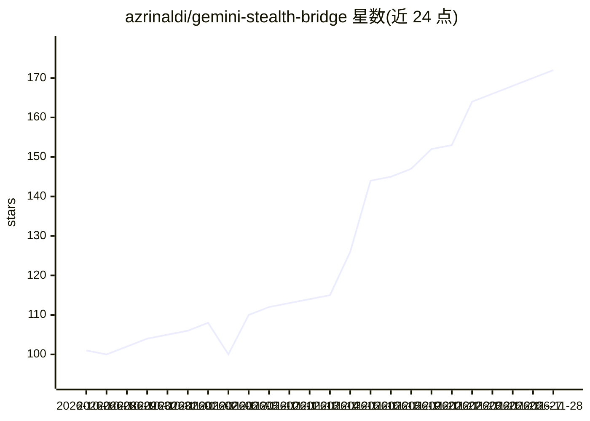

# azrinaldi/gemini-stealth-bridge

⭐ 172 · Go · MIT · 推送 2026-11-22 · [GitHub](https://github.com/azrinaldi/gemini-stealth-bridge) · 个人维护

**把 Gemini Web 账号以 OpenAI 兼容 API 暴露的多账号代理**

用 Go 编写的非官方 HTTP 代理：通过浏览器登录捕获 Google 会话 Cookie，经 uTLS/HTTP2 无浏览器传输访问 Gemini Web，对外提供 /v1/chat/completions、/v1/responses、图像与视频生成端点及 MCP web_search 服务器。支持多 Google 账号池、rotate/lru/fill-first 轮换策略、5 小时与 7 天配额跟踪和故障转移；内置 /ui 控制面板管理账号、配额与运行时设置。提供多平台预编译二进制、源码构建与 Docker Compose 部署。上游接口变更可能导致不可用。

## 筛选速览

| 维度 | 判定 | 备注 |
|---|---|---|
| AI 角色 | `ai-ecosystem` | LLM/agent 周边工具 |
| 许可风险 | `permissive` | MIT |
| 部署形态 | `desktop` | 安装包/桌面程序 |
| 模型依赖 | — | README 未给出锁定关系 |
| 硬件要求 | — | 无带数字的原话,不猜 |
| 安装摩擦 | `low` | 无编译、无系统依赖或容器化 |
| 成熟度 | — | 结构信号不足 |

## 能力要点

- OpenAI Chat Completions 与 Responses API 兼容端点（JSON/SSE）
- 多账号池与配额感知故障转移（rotate/lru/fill-first）
- Imagen/Veo 原生图像与视频生成端点
- 内置 MCP web_search 服务器与 Web 控制面板

## 适用场景

- 让只支持 OpenAI SDK 的客户端接入 Google 账号下的 Gemini Web
- 用多个 Google 账号池化配额并自动故障转移
- 在无头 VPS 上通过桌面 UI 转发完成账号登录

## 场景标签

`模型网关` · 领域:Agent 开发

## 证据(README 行号)

> L9: OpenAI-compatible HTTP proxy for Gemini Web. Use your Google account with OpenAI SDKs, routers (`9router`), and codi
> L13: > **Unofficial.** `gsb` authenticates with Google session cookies over a browserless uTLS/HTTP2 transport (no headl

## 星数曲线

2026-10-26 101 → 2026-11-28 172（+71）

---
*卡片 v1 · prompt 1.4 · 生成 2026-11-26 · 置信度 high · 依据 README sha `15c3770393b3` · [字段定义](../../DATASET.md)*
