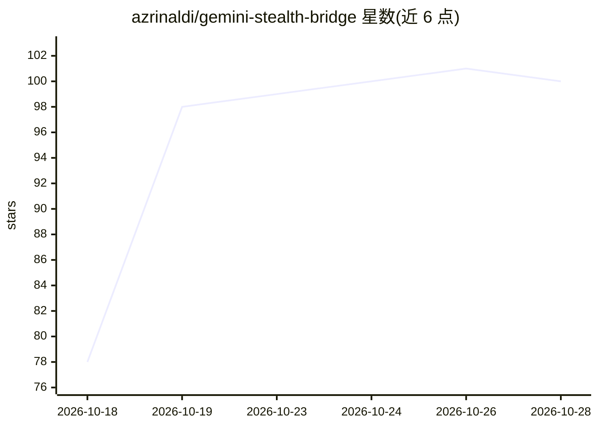

# azrinaldi/gemini-stealth-bridge

⭐ 102 · Go · MIT · 推送 2026-10-22 · [GitHub](https://github.com/azrinaldi/gemini-stealth-bridge) · 个人维护

**将 Gemini Web 账号转为 OpenAI 兼容 API 的本地代理守护进程**

用 Go 编写的单二进制守护进程：把 OpenAI 风格的消息、图片与工具定义翻译成 Gemini Web 请求，通过 /v1/chat/completions 与 /v1/responses 返回 JSON 或 SSE。认证使用 Google 会话 cookie 而非 Developer API key，支持多账号池化、配额感知故障转移、每账号出口代理、搜索引用、Imagen/Veo 媒体生成与内置 MCP 端点，并带 Web 控制面板。声明为非官方桥接，Google 协议变更可能中断运行；不支持 temperature 等采样参数转发、音频输入与 embeddings。供希望在 OpenAI SDK 客户端、编码 agent 或路由器中使用 Gemini Web 账号的开发者部署。

## 筛选速览

| 维度 | 判定 | 备注 |
|---|---|---|
| AI 角色 | `ai-ecosystem` | LLM/agent 周边工具 |
| 许可风险 | `permissive` | MIT |
| 部署形态 | `desktop` | 安装包/桌面程序 |
| 模型依赖 | — | README 未给出锁定关系 |
| 硬件要求 | — | 无带数字的原话,不猜 |
| 安装摩擦 | `low` | 无编译、无系统依赖或容器化 |
| 成熟度 | — | 结构信号不足 |

## 能力要点

- OpenAI 兼容的 Chat Completions 与 Responses 端点，JSON/SSE 输出
- 多账号池化（rotate/lru/fill-first）与 5 小时/7 天配额窗口感知故障转移
- 内置 Streamable HTTP MCP 端点，向 MCP 客户端暴露 web_search 工具
- 静态单二进制发布（Linux/macOS/Windows，amd64/arm64），含 Web 控制面板

## 适用场景

- 让 OpenAI SDK 客户端或编码 agent 通过 Gemini Web 账号获得模型输出
- 多个 Google 账号池化管理配额并自动故障转移
- 通过 MCP 给 Claude Code、Cursor 等客户端提供带引用的搜索工具

## 场景标签

`模型网关` · 领域:Agent 开发

## 证据(README 行号)

> L9: OpenAI-compatible proxy for Gemini Web. Point coding agents, routers, and OpenAI SDK clients at `gsb` and use your G
> L13: `gsb` translates OpenAI-style messages, images, and tool definitions into Gemini Web requests, then converts the re

## 星数曲线

2026-10-18 78 → 2026-10-28 100（+22）

---
*卡片 v1 · prompt 1.4 · 生成 2026-10-23 · 置信度 high · 依据 README sha `2c3a7c1d2b45` · [字段定义](../../DATASET.md)*
