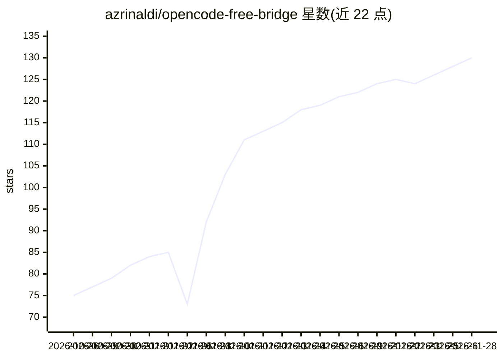

# azrinaldi/opencode-free-bridge

⭐ 130 · JavaScript · MIT · 推送 2026-11-10 · [GitHub](https://github.com/azrinaldi/opencode-free-bridge) · 个人维护

**本地 OpenAI 兼容桥：让任意客户端调用 OpenCode 免费层模型**

运行在 Bun 上的本地代理服务器（默认 127.0.0.1:20129/v1），将 OpenAI/Anthropic 兼容请求转发到 OpenCode 免费层模型，无需账号与 API key。核心机制包括：从 OpenCode 更新 API、GitHub 源码与 models.opencode.ai 派生模型目录并缓存到本地；复刻官方 CLI 的 TLS ClientHello 指纹（17 个 cipher suite、12 个扩展）以通过免费层门控；遇 403 FreeTierError 时自动刷新会话身份并重试一次，带 30 秒 IP 冷却保护；对推理模型应用令牌预算下限。零依赖，仅用内置模块。支持 Linux（systemd）与 macOS（launchd），不支持 Windows 原生。

## 筛选速览

| 维度 | 判定 | 备注 |
|---|---|---|
| AI 角色 | `ai-ecosystem` | LLM/agent 周边工具 |
| 许可风险 | `permissive` | MIT |
| 部署形态 | `self-host` | docker 或自建部署 |
| 模型依赖 | locked-api |  |
| 硬件要求 | — | 无带数字的原话,不猜 |
| 安装摩擦 | `low` | 无编译、无系统依赖或容器化 |
| 成熟度 | — | 结构信号不足 |

## 能力要点

- 复刻 OpenCode CLI 的 TLS ClientHello 指纹以通过免费层门控
- 模型目录从上游 API/GitHub 动态派生并本地缓存
- 403/426/404 时自愈：刷新会话、重试一次、30s IP 冷却
- 零依赖运行，提供 Dockerfile 与 docker-compose 部署

## 适用场景

- 在 Cursor、Continue、Open WebUI 等兼容客户端中调用免费模型
- 本地开发时无需注册账号即可使用 OpenCode 免费层
- 用 LiteLLM 等网关统一接入 OpenCode 免费模型

## 场景标签

`模型网关` · 领域:Agent 开发

## 证据(README 行号)

> L3: OpenAI/Anthropic-compatible local API bridge for OpenCode free-tier models. No account and no API key required.
> L5: It runs a local server on `http://127.0.0.1:20129/v1` that any OpenAI-compatible client (9Router, Cursor, Continue, 

## 星数曲线

2026-10-26 75 → 2026-11-28 130（+55）

---
*卡片 v1 · prompt 1.4 · 生成 2026-11-28 · 置信度 mid · 依据 README sha `bc3b9ba87889` · [字段定义](../../DATASET.md)*
