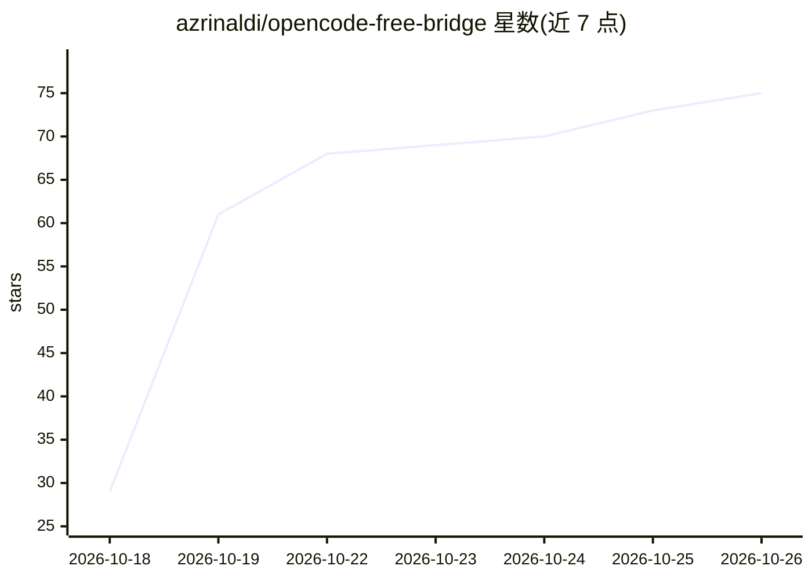

# azrinaldi/opencode-free-bridge

⭐ 75 · JavaScript · MIT · 推送 2026-10-25 · [GitHub](https://github.com/azrinaldi/opencode-free-bridge) · 个人维护

**把 OpenCode 免费层模型桥接为本地 OpenAI 兼容 API，无需账号**

在本地运行 Bun 服务器（默认 127.0.0.1:20129/v1），把 OpenAI 兼容客户端的请求转发到 OpenCode 免费层推理端点，无需账号与 API key。它从上游更新 API、GitHub 仓库与 models.opencode.ai 派生客户端身份（会话 ID、工具插件、端点、模型目录），并复现 OpenCode CLI 的 TLS ClientHello 指纹以通过免费层网关；遇到 403/426/404 时自动刷新配方、换新会话 ID 并重试。提供一键安装脚本（Linux systemd / macOS launchd）、Dockerfile 与 docker-compose，仅监听回环地址且无鉴权（API key 为 public）。Windows 不支持，需 WSL。

## 筛选速览

| 维度 | 判定 | 备注 |
|---|---|---|
| AI 角色 | `ai-ecosystem` | LLM/agent 周边工具 |
| 许可风险 | `permissive` | MIT |
| 部署形态 | `self-host` | docker 或自建部署 |
| 模型依赖 | — | README 未给出锁定关系 |
| 硬件要求 | — | 无带数字的原话,不猜 |
| 安装摩擦 | `low` | 无编译、无系统依赖或容器化 |
| 成熟度 | — | 结构信号不足 |

## 能力要点

- OpenAI 兼容本地 API，供 Cursor/Continue/Open WebUI 等客户端直连
- 从上游源码与 API 派生客户端身份与免费模型目录，本地拒绝已退役或付费模型
- TLS ClientHello 指纹与 OpenCode CLI 对齐（需 Bun 运行时，Node 会被上游 403）
- 403/426/404 多层自愈重试与 IP 冷却保护

## 适用场景

- 让 Cursor/Continue 等已有 OpenAI 兼容客户端调用 OpenCode 免费模型
- 在 Linux/macOS 上以 systemd/launchd 服务或 Docker 常驻运行本地桥
- 离线冷启动时利用磁盘模型目录缓存快速响应

## 场景标签

`模型网关` · 领域:Agent 开发

## 证据(README 行号)

> L3: OpenAI-compatible local API bridge for OpenCode free-tier models. No account and no API key required.
> L5: It runs a local server on `http://127.0.0.1:20129/v1` that any OpenAI-compatible client (9Router, Cursor, Continue, 

## 星数曲线

2026-10-18 29 → 2026-10-26 75（+46）

---
*卡片 v1 · prompt 1.4 · 生成 2026-10-24 · 置信度 mid · 依据 README sha `a66f61143789` · [字段定义](../../DATASET.md)*
