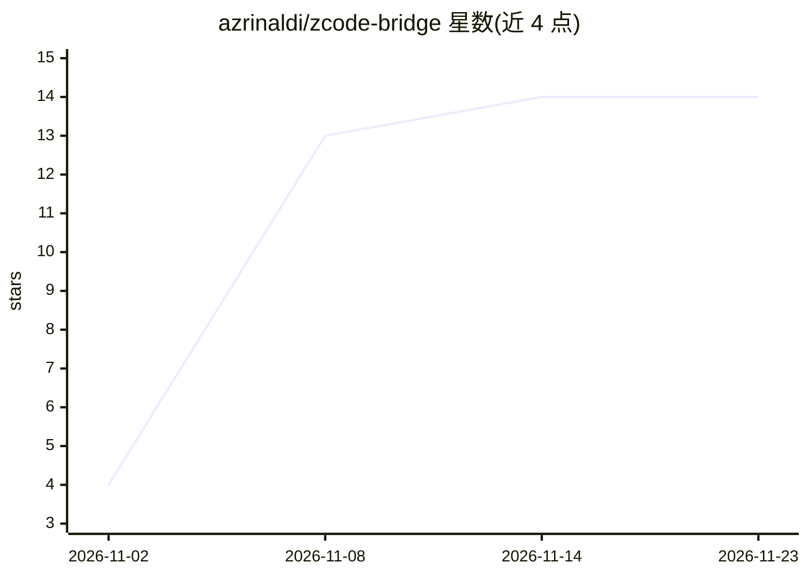

# azrinaldi/zcode-bridge

⭐ 14 · Go · MIT · 推送 2026-11-03 · [GitHub](https://github.com/azrinaldi/zcode-bridge) · 个人维护 · 中文 README

**把 ZCode 套餐额度转为 OpenAI/Anthropic 兼容 API 的本地网关**

用 Go 编写的单二进制本地 HTTP 网关，将 ZCode Start Plan（GLM-5.3/GLM-5.3-Flash）的套餐额度以 OpenAI 与 Anthropic 两种线格式暴露：/v1/messages 直接透传，/v1/chat/completions 双向翻译（含流式与工具调用）。通过设备流登录复用桌面端凭据，支持多账户轮换、冷却与后台令牌刷新，并提供配额查询、模型列表与重试/退避等传输层机制。面向希望让 Claude Code、Aider 或任意 OpenAI SDK 使用既有套餐额度的开发者。仅标准库、无运行时依赖。

## 筛选速览

| 维度 | 判定 | 备注 |
|---|---|---|
| AI 角色 | `ai-ecosystem` | LLM/agent 周边工具 |
| 许可风险 | `permissive` | MIT |
| 部署形态 | `desktop` | 安装包/桌面程序 |
| 模型依赖 | — | README 未给出锁定关系 |
| 硬件要求 | — | 无带数字的原话,不猜 |
| 安装摩擦 | `low` | 无编译、无系统依赖或容器化 |
| 成熟度 | — | 结构信号不足 |

## 能力要点

- 同时暴露 OpenAI 与 Anthropic 线格式，含流式 SSE 翻译与工具调用映射
- 设备流登录复用桌面端凭据，令牌以 0600 权限本地存储
- 多账户环：可切换错误时自动轮换、冷却与后台刷新
- 单静态 Go 二进制，仅标准库，无运行时依赖

## 适用场景

- 让 Claude Code、Aider 等客户端走 ZCode 套餐额度
- 用任意 OpenAI SDK 以本地 base_url 调用 GLM-5.3 系列
- 查询与监控套餐各授权项的余量

## 场景标签

`模型网关` · 领域:Agent 开发

## 证据(README 行号)

> L8: OpenAI- and Anthropic-compatible HTTP front end for the **ZCode start-plan
> L78: |`POST /v1/chat/completions`|OpenAI|translated both ways, incl. streaming + tools|

## 星数曲线

2026-11-02 4 → 2026-11-23 14（+10）

---
*卡片 v1 · prompt 1.4 · 生成 2026-11-18 · 置信度 high · 依据 README sha `dfd958da2aab` · [字段定义](../../DATASET.md)*
