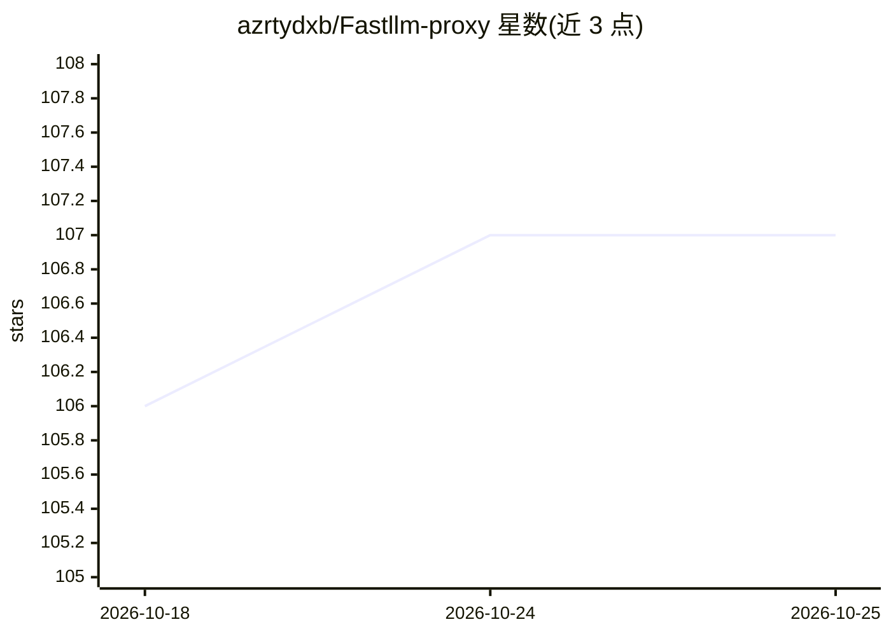

# azrtydxb/Fastllm-proxy

⭐ 107 · Rust · Apache-2.0 · 推送 2026-10-25 · [GitHub](https://github.com/azrtydxb/Fastllm-proxy) · [官网](https://fastllm.azrty.com/) · 个人维护

**Rust 编写的低开销 LLM 网关：统一 OpenAI 兼容端点路由 81 家提供商**

用 Rust 编写的 LLM 反向代理/路由器，在自托管 vLLM、SGLang、llama.cpp 及 81 家提供商前提供单一 OpenAI 兼容端点。关键机制：请求路径无 I/O、响应体不解析直接透传、面向 vLLM/SGLang KV 缓存的亲和性路由、规则与语义路由、RBAC 与 API key/预算控制、控制面/数据面分离、读取 LiteLLM 格式配置。以 Docker Compose 方式提供快速启动，内含 13 屏管理 UI。

## 筛选速览

| 维度 | 判定 | 备注 |
|---|---|---|
| AI 角色 | `ai-ecosystem` | LLM/agent 周边工具 |
| 许可风险 | `permissive` | Apache-2.0 |
| 部署形态 | `self-host` | docker 或自建部署 |
| 模型依赖 | local-ok | 支持本地模型 |
| 硬件要求 | — | 无带数字的原话,不猜 |
| 安装摩擦 | `low` | 无编译、无系统依赖或容器化 |
| 成熟度 | — | 结构信号不足 |

## 能力要点

- 单一 OpenAI 兼容端点接入 81 家提供商及任意 OpenAI 兼容端点
- 缓存亲和性路由与规则/语义双模式前端模型路由
- 请求路径零 I/O：RBAC、限流、预算为内存快照整数比较
- 直接读取 LiteLLM 格式配置文件，可替换现有部署

## 适用场景

- 在多个自托管与托管推理后端前统一入口做负载均衡与故障转移
- 按调用者、token 用量、时段等条件做模型级路由与预算控制
- 为团队 LLM 服务提供 RBAC、限流与用量核算

## 场景标签

`模型网关` · 领域:Agent 开发

## 证据(README 行号)

> L8: **The lowest-overhead LLM router.** Production-ready, highly available, and one OpenAI-compatible endpoint in front 
> L10: It fronts any number of inference backends (vLLM, SGLang, llama.cpp, or any of 81 providers) behind one address: **

## 星数曲线

2026-10-18 106 → 2026-10-25 107（+1）

---
*卡片 v1 · prompt 1.4 · 生成 2026-10-23 · 置信度 high · 依据 README sha `217f6d4545f6` · [字段定义](../../DATASET.md)*
