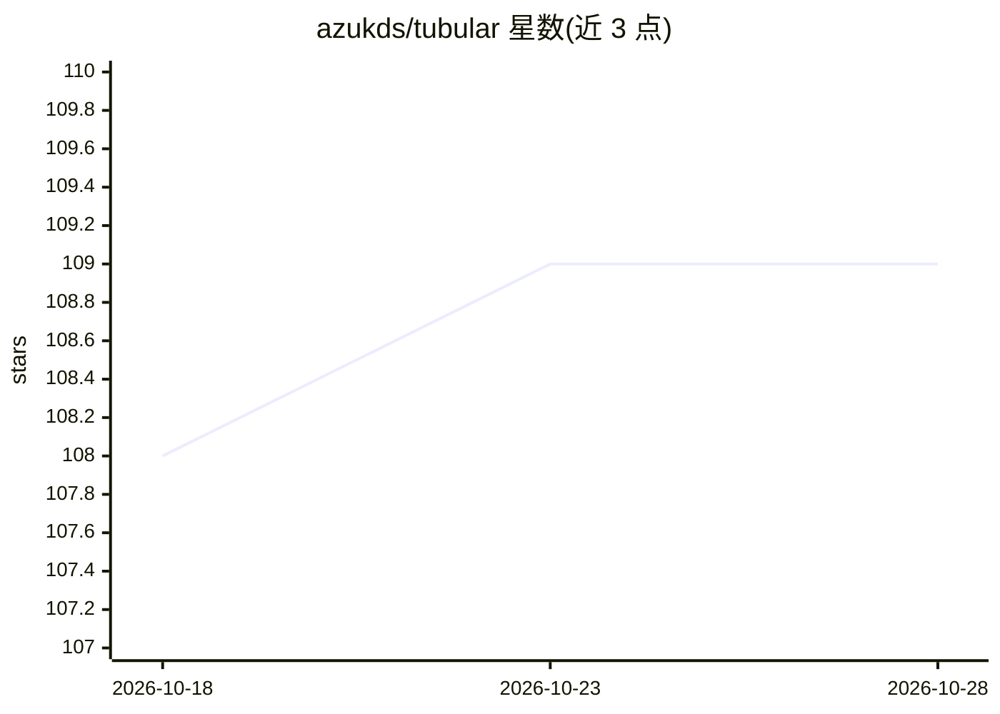

# azukds/tubular

⭐ 109 · Python · BSD-3-Clause · 推送 2026-10-28 · [GitHub](https://github.com/azukds/tubular) · [官网](https://tubular.readthedocs.io/en/latest/index.html) · 组织维护

**面向 pandas/polars 的机器学习表格预处理与特征工程库**

Python 包 tubular 实现机器学习管线中常用的表格数据预处理步骤：capping、日期处理、缺失值填充、映射、类别编码与数值运算等。转换器基于 narwhals 编写，可在 pandas 与 polars 数据帧间通用，并提供 fit/transform 方法，兼容 scikit-learn Pipeline。支持将转换器与管线以 JSON 格式保存和读取（替代 pickle）。polars LazyFrame 支持正在逐步推出，README 附有各转换器的兼容性表格。通过 PyPI 提供，文档托管于 readthedocs。

## 筛选速览

| 维度 | 判定 | 备注 |
|---|---|---|
| AI 角色 | `ai-ecosystem` | LLM/agent 周边工具 |
| 许可风险 | `permissive` | BSD-3-Clause |
| 部署形态 | `library` | 以包/库形式分发 |
| 模型依赖 | — | README 未给出锁定关系 |
| 硬件要求 | — | 无带数字的原话,不猜 |
| 安装摩擦 | `low` | 无编译、无系统依赖或容器化 |
| 成熟度 | — | 结构信号不足 |

## 能力要点

- 提供 capping、日期、填充、映射、类别编码、数值运算等类别转换器
- 基于 narwhals，pandas 与 polars 数据帧通用
- 兼容 scikit-learn Pipeline，各转换器带 fit/transform 方法
- 转换器与管线支持 JSON 格式保存/读取

## 适用场景

- 在 scikit-learn 管线中做表格数据的特征工程与预处理
- 同一套预处理代码在 pandas 和 polars 数据帧上复用
- 以 JSON 替代 pickle 保存预处理管线

## 场景标签

 · 领域:机器学习/数据科学工具

## 证据(README 行号)

> L11: `tubular` implements pre-processing steps for tabular data commonly used in machine learning pipelines.
> L13: The transformers are compatible with scikit-learn Pipelines. Each has a `transform` method to apply the pre-process
> L15: The transformers in `tubular` are written in narwhals narwhals, so are agnostic between pandas and polars dataframe

## 星数曲线

2026-10-18 108 → 2026-10-28 109（+1）

---
*卡片 v1 · prompt 1.4 · 生成 2026-10-23 · 置信度 high · 依据 README sha `8e992bba5dee` · [字段定义](../../DATASET.md)*
