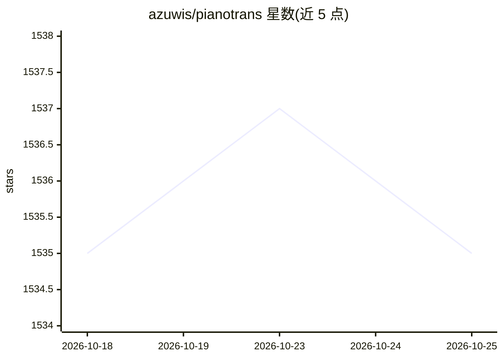

# azuwis/pianotrans

⭐ 1,534 · Nix · 推送 2026-09-14 · [GitHub](https://github.com/azuwis/pianotrans) · 个人维护

**钢琴转录模型 ByteDance Piano Transcription 的 GUI 封装，音频转 MIDI**

为字节跳动的钢琴转录系统（PyTorch 实现）提供图形界面与打包：选择音频/视频文件，批量转录为带踏板信息的 MIDI 文件，输出到源文件同目录。提供 GUI 与 CLI 两种用法。Windows 提供 1.5GB 压缩包（需先装 VC++ 运行库），Linux/macOS 通过 Nix 安装；自动使用 GPU 推理，可切换 CPU。转录效果问题指向上游项目，本项目仅负责封装打包。

## 筛选速览

| 维度 | 判定 | 备注 |
|---|---|---|
| AI 角色 | `ai-native` | 本体是模型或模型工具 |
| 许可风险 | `none` | — |
| 部署形态 | `desktop` | 安装包/桌面程序 |
| 模型依赖 | — | README 未给出锁定关系 |
| 硬件要求 | — | 无带数字的原话,不猜 |
| 安装摩擦 | `low` | 无编译、无系统依赖或容器化 |
| 成熟度 | — | 结构信号不足 |

## 能力要点

- 批量选择音频/视频文件转录为带踏板的 MIDI
- Windows 预打包发行版与右键菜单集成
- 自动 GPU 推理，PianoTrans-CPU.bat 可强制 CPU
- Nix 支持 Linux/macOS，另有 CLI 用法

## 适用场景

- 把自己弹的钢琴录音转成 MIDI 文件
- 批量处理多个音频/视频文件的钢琴转录
- 不熟悉命令行的用户直接用 GUI 使用转录模型

## 场景标签

 · 领域:音乐/音频 AI 工具

## 证据(README 行号)

> L9: Using this, we can transcribe piano recordings into MIDI files with pedals.
> L32: PianoTrans automatically uses GPU for inference, if you encounter any problem,

## 星数曲线

2026-10-18 1,535 → 2026-10-25 1,535（+0）

---
*卡片 v1 · prompt 1.4 · 生成 2026-10-21 · 置信度 high · 依据 README sha `882b028b1425` · [字段定义](../../DATASET.md)*
