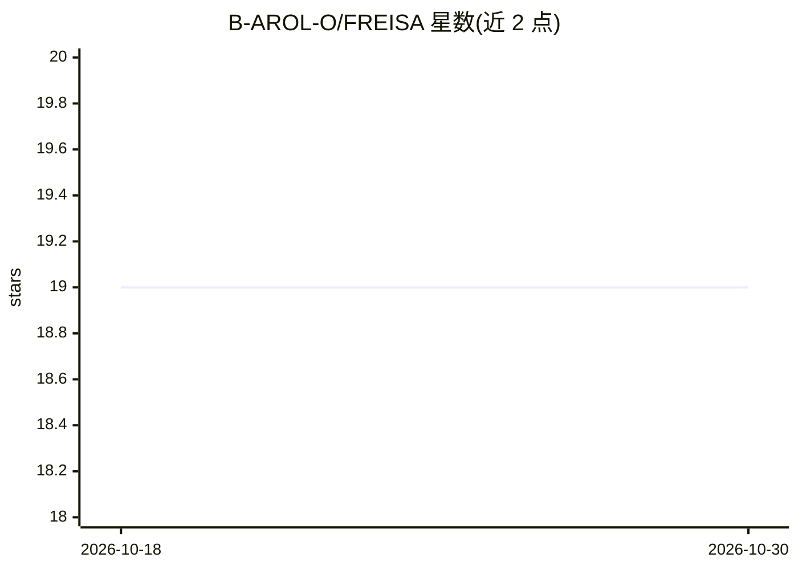

# B-AROL-O/FREISA

⭐ 19 · Jupyter Notebook · MIT · 推送 2026-09-14 · [GitHub](https://github.com/B-AROL-O/FREISA) · [官网](https://github.com/B-AROL-O/FREISA) · 组织维护

**四足机器狗项目：智能灌溉 + 语音交互机器人助手**

B-AROL-O 团队基于 Mangdang MiniPupper 与 ROS2 Humble 的四足机器狗项目。原始形态面向智能灌溉（2023 OpenCV AI 竞赛大奖）；后续 FREISA-GPT 接入 gpt-oss-20b 开源权重 LLM，用 Whisper 将语音指令转为提示词，生成 JSON 结构化响应，经 ros-mcp-server 执行机器人物理动作，并通过 Puppy State Manager 显示表情与声音。README 提供仿真运行指引与演示视频，未给出完整安装命令；代码以 MIT 许可，文档 CC BY-SA 4.0，使用 REUSE 规范管理许可信息。

## 筛选速览

| 维度 | 判定 | 备注 |
|---|---|---|
| AI 角色 | `ai-enhanced` | 去掉 AI 部分产品仍成立 |
| 许可风险 | `permissive` | MIT |
| 部署形态 | `None` |  |
| 模型依赖 | — | README 未给出锁定关系 |
| 硬件要求 | — | 无带数字的原话,不猜 |
| 安装摩擦 | `low` | 无编译、无系统依赖或容器化 |
| 成熟度 | — | 结构信号不足 |

## 能力要点

- gpt-oss-20b 驱动的语音指令交互（Whisper 转提示词）
- 通过 ros-mcp-server 与 ROS2 Humble 执行物理动作
- Puppy State Manager 显示表情与声音
- OpenCV AI Competition 2023 大奖项目

## 适用场景

- 搭建语音控制的四足机器人助手
- 在仿真环境中运行 FREISA-GPT 验证语音管线
- 参考 MiniPupper + LLM + MCP 的机器人集成方案

## 场景标签

`语音识别` · 领域:感知与多模态

## 证据(README 行号)

> L11: FREISA-GPT transforms the original FREISA robotic dog into an **intelligent assistant** powered by **gpt-oss-20b** 
> L15: - Executes **physical actions** (for instance, to move or rotate the robot) thanks to ros-mcp-server and ROS2 Humbl

## 星数曲线

2026-10-18 19 → 2026-10-30 19（+0）

---
*卡片 v1 · prompt 1.4 · 生成 2026-10-29 · 置信度 mid · 依据 README sha `8f4bc9a65cf4` · [字段定义](../../DATASET.md)*
