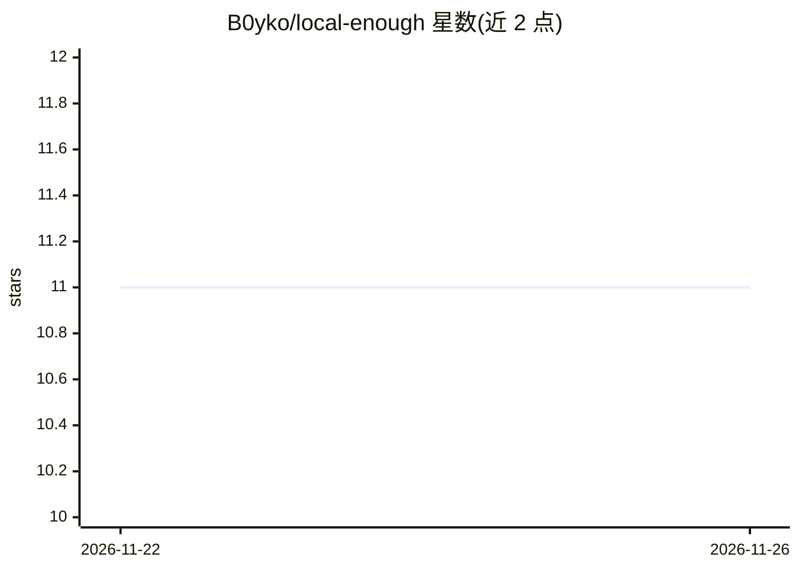

# B0yko/local-enough

⭐ 11 · Python · Apache-2.0 · 推送 2026-11-20 · [GitHub](https://github.com/B0yko/local-enough) · [官网](https://boiko.ai/work/local-enough/) · 个人维护

**评测 AI 任务能否在本地硬件运行并测算千次成本**

一个基准评测与路由 CLI：对五个后台办公任务（CRM 信息抽取、意图分类、PII 脱敏、会议摘要、记录匹配）在本地 MLX 模型与云模型上以相同提示词测量准确率、延迟、吞吐与每千次任务美元成本，含硬件摊销与能耗，输出决策报告与 ADR，并生成 OpenAI 兼容路由器，把每个任务发送到满足质量门槛的最便宜模型，必须本地处理的任务不经过云端。参考运行基于 Mac Studio M4 Max 128GB；Linux 上不支持本地 MLX 路径，仅云与 OpenAI 兼容端点可用。

## 筛选速览

| 维度 | 判定 | 备注 |
|---|---|---|
| AI 角色 | `ai-ecosystem` | LLM/agent 周边工具 |
| 许可风险 | `permissive` | Apache-2.0 |
| 部署形态 | `self-host` | docker 或自建部署 |
| 模型依赖 | locked-api |  |
| 硬件要求 | — | 无带数字的原话,不猜 |
| 安装摩擦 | `low` | 无编译、无系统依赖或容器化 |
| 成熟度 | — | 结构信号不足 |

## 能力要点

- 本地与云模型同题基准：准确率置信区间、p50/p95 延迟、吞吐、USD/千次任务与回本量
- OpenAI 兼容路由器按质量门槛选最便宜模型，带确定性门控与升级链
- LLM judge 经 Rogan–Gladen 偏差校正，摘要按事实级判分
- 全部表格可离线复现自提交的运行数据，CI 校验 README 漂移

## 适用场景

- 评估后台 AI 任务该跑本地还是云及其成本临界量
- PII 等必须本地处理的任务的合规评测
- 为混合负载生成按任务分配本地/云端的路由方案

## 场景标签

`模型评测` · 领域:评测与运维

## 证据(README 行号)

> L1: local-enough: can this AI task run on your own hardware, and what does it cost?
> L25: |Local models on Apple Silicon and cloud models run the same five back-office tasks (CRM extraction, intent classif
> L137: 5. **Route.** The planner keeps, per task, the candidates that met the quality bar on `calib`, orders them by USD 

## 星数曲线

2026-11-22 11 → 2026-11-26 11（+0）

---
*卡片 v1 · prompt 1.4 · 生成 2026-11-22 · 置信度 mid · 依据 README sha `7278b6c73738` · [字段定义](../../DATASET.md)*
