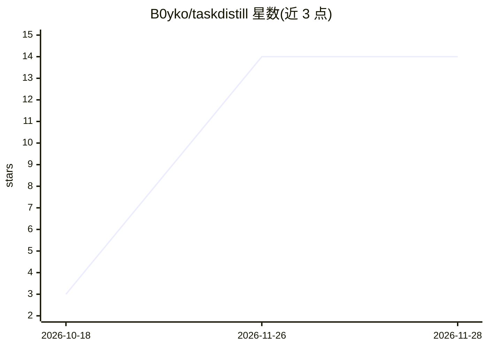

# B0yko/taskdistill

⭐ 14 · Python · Apache-2.0 · 推送 2026-11-20 · [GitHub](https://github.com/B0yko/taskdistill) · [官网](https://boiko.ai/work/taskdistill/) · 个人维护

**把重复性 API 调用蒸馏成本地小模型的级联流水线工具**

面向拥有固定狭窄 LLM 调用（如意图分类、字段抽取）的工程师：通过捕获代理收录应用已发送的 OpenAI 格式请求，整理为训练数据（去重、PII 清洗、划分防泄漏），用 MLX 在 Apple Silicon 上对 0.5B–1.5B Qwen2.5 做 LoRA 微调，在留出数据上评估并按验证集选定置信阈值，再以 OpenAI 兼容级联服务器提供——学生先答，低置信时转交原模型。应用只需改 base URL。评估报告含基线、置信区间与成本回收测算；发票任务在测试集未达 97% 目标（94.1%）。

## 筛选速览

| 维度 | 判定 | 备注 |
|---|---|---|
| AI 角色 | `ai-ecosystem` | LLM/agent 周边工具 |
| 许可风险 | `permissive` | Apache-2.0 |
| 部署形态 | `library` | 以包/库形式分发 |
| 模型依赖 | — | README 未给出锁定关系 |
| 硬件要求 | — | 无带数字的原话,不猜 |
| 安装摩擦 | `medium` | 含编译或系统依赖之一 |
| 成熟度 | — | 结构信号不足 |

## 能力要点

- 捕获代理→数据整理→LoRA 训练→评估→级联服务的一体化本地流水线
- OpenAI 兼容级联服务：低置信请求自动转交教师模型，客户端仅改 base URL
- 阈值与模型选择仅允许使用验证集，违反则抛出 TypeError
- 报告含 $/1k 请求、延迟与盈亏平衡量，可从真实服务流量重算

## 适用场景

- 把支撑工单分类这类高频窄任务从付费 API 蒸馏到本地小模型
- 用已有请求日志构建训练集并量化学生与教师的差异
- 在 Apple Silicon 上离线复现级联的质量/成本评估报告

## 场景标签

`模型网关` `模型评测` `微调` · 领域:Agent 开发

## 证据(README 行号)

> L17: taskdistill captures the traffic your application already sends, curates it into training data, LoRA fine-tunes a
> L115: |Serve|`taskdistill serve --task T`|FastAPI server with `/v1/chat/completions`, `/v1/models`, `/healthz` and `/met
> L59: On an Apple Silicon Mac (macOS 14 or later) with uv

## 星数曲线

2026-10-18 3 → 2026-11-28 14（+11）

---
*卡片 v1 · prompt 1.4 · 生成 2026-11-26 · 置信度 high · 依据 README sha `e0cdaf00810b` · [字段定义](../../DATASET.md)*
