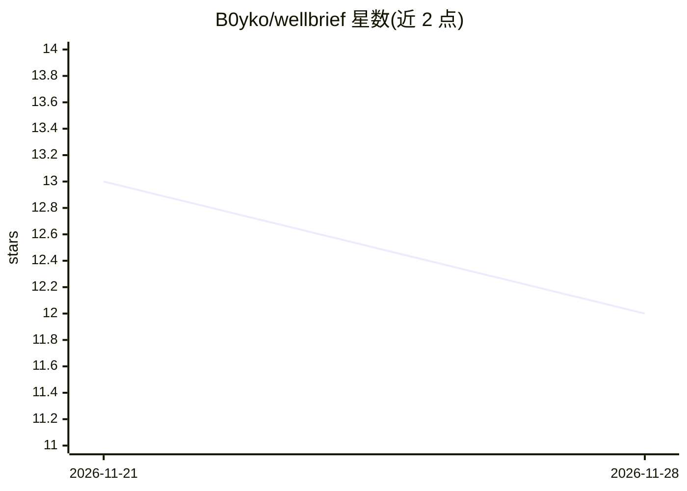

# B0yko/wellbrief

⭐ 12 · Python · Apache-2.0 · 推送 2026-11-06 · [GitHub](https://github.com/B0yko/wellbrief) · [官网](https://boiko.ai/work/wellbrief/) · 个人维护

**给钻井工程师的离线问答工具：引用逐字核验**

面向钻井工程领域的离线检索问答工具：读取井场日报、完井报告与事故报告（.txt/.md/.pdf/.docx/.csv），回答带逐字核验引用的问题，并基于邻井 NPT 台账生成开钻前风险简报，含费用按钻机日费折算与缓解措施原文引用。检索为结构化过滤加 BM25 与哈希嵌入的 RRF 融合；数字经 SQL 独立计算；验证器逐项核对文档 id、数字与井名，失败则回退到确定性离线叙述并显示横幅。进程级守卫阻断出站连接，narrator 可接任意 OpenAI 兼容 /chat/completions 服务，非回环地址需环境变量显式放行。提供 uvx 与 Docker 两种运行方式及 52 用例评测套件。

## 筛选速览

| 维度 | 判定 | 备注 |
|---|---|---|
| AI 角色 | `ai-native` | 本体是模型或模型工具 |
| 许可风险 | `permissive` | Apache-2.0 |
| 部署形态 | `self-host` | docker 或自建部署 |
| 模型依赖 | — | README 未给出锁定关系 |
| 硬件要求 | — | 无带数字的原话,不猜 |
| 安装摩擦 | `low` | 无编译、无系统依赖或容器化 |
| 成熟度 | — | 结构信号不足 |

## 能力要点

- 逐字核验引用：987/987 条引用通过验证器核对
- 进程级网络守卫阻断出站连接与 DNS 查询，支持 --network none 容器验证
- 风险简报直接读取 NPT 台账，无检索步骤，缓解措施仅取自成功避障井
- 内置 52 用例评测套件，结果以带 git SHA 的 JSON 提交

## 适用场景

- 开钻前从邻井报告生成风险简报与 NPT 费用预估
- 在气隙环境检索井场报告归档并核查答案出处
- 对自有报告模板用 wellbrief.toml 适配后无需改代码接入

## 场景标签

`RAG` `文档问答` · 领域:知识与检索

## 证据(README 行号)

> L5: Offline retrieval-augmented answers and pre-spud offset-well risk briefs over a field's own
> L65: - `wellbrief` ingests the archive, answers questions with citations checked word for word
> L134: - The `llm` narrator talks to any OpenAI-compatible `/chat/completions` server —

## 星数曲线

2026-11-21 13 → 2026-11-28 12（-1）

---
*卡片 v1 · prompt 1.4 · 生成 2026-11-21 · 置信度 mid · 依据 README sha `b865b7ff2e96` · [字段定义](../../DATASET.md)*
