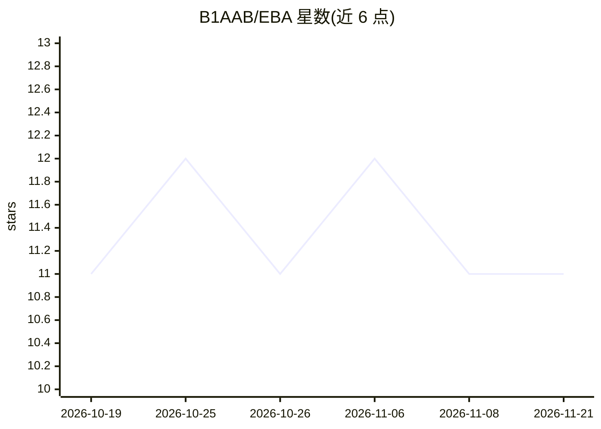

# B1AAB/EBA

⭐ 11 · C# · GPL-3.0 · 推送 2026-11-15 · [GitHub](https://github.com/B1AAB/EBA) · [官网](https://eba.b1aab.ai/) · 组织维护

**面向机器学习的比特币链上资金流时序图数据集**

EBA 对接比特币网络，基于 UTxO 模型把链上全部交易历史构建为时序图：节点为脚本（地址），边为带时间戳的定向交易边，可通过路径遍历追踪资金收支流向。图原生面向机器学习尤其是图神经网络（GNN）设计，支持邻居聚合与消息传递学习资金流拓扑。数据覆盖逾 87.2 亿 BTC、24 亿节点与 397.2 亿条边；项目发布完整 ETL 管线与全部生成数据，拆分为多个子仓库，并提供 Quick Start 笔记本、文档与交互式 demo。

## 筛选速览

| 维度 | 判定 | 备注 |
|---|---|---|
| AI 角色 | `ai-knowledge` | 知识聚合/清单类 |
| 许可风险 | `viral` | GPL-3.0 |
| 部署形态 | `None` |  |
| 模型依赖 | — | README 未给出锁定关系 |
| 硬件要求 | — | 无带数字的原话,不猜 |
| 安装摩擦 | `low` | 无编译、无系统依赖或容器化 |
| 成熟度 | — | 结构信号不足 |

## 能力要点

- 覆盖 24 亿节点、397.2 亿条带时间戳边的全量链上交易图
- 原生为 GNN 设计，支持消息传递与邻居聚合
- 开放完整 ETL 管线及全部生成数据
- 提供 101 Quick Start Jupyter Notebook 与在线交互 demo

## 适用场景

- 为 GNN 模型准备比特币链上资金流的时序图训练数据
- 研究加密货币生态中的资金流拓扑与路径追踪
- 基于链上图数据构建机器学习应用

## 场景标签

 · 领域:区块链/机器学习数据集

## 证据(README 行号)

> L30: This graph is built natively for machine learning,
> L46: We share the complete ETL pipeline and all the data it generates.

## 星数曲线

2026-10-19 11 → 2026-11-21 11（+0）

---
*卡片 v1 · prompt 1.4 · 生成 2026-11-19 · 置信度 high · 依据 README sha `7d6c02eb5a09` · [字段定义](../../DATASET.md)*
