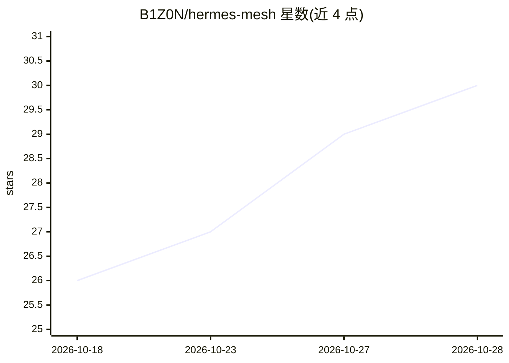

# B1Z0N/hermes-mesh

⭐ 30 · Shell · MIT · 推送 2026-07-18 · [GitHub](https://github.com/B1Z0N/hermes-mesh) · 个人维护

**跨机器同步 Hermes agent 技能与长期记忆的 Git 同步工具**

面向在多台机器上运行 Hermes agent 的用户：以 VPS 上的 Git 裸仓库为共享中枢，每 15 分钟由 cron/launchd 触发拉取-合并-推送，同步 skills 目录、agent 记忆与用户画像；机器特定事实（硬件、IP、本地路径）通过 ⟨machine:⟩ 标签留在本地，密钥与令牌不同步。冲突采用三方合并，双方不一致时由 LLM 逐条裁决（每条 120 秒超时）。以 bash 脚本集（setup/sync/update/test/uninstall）形式提供，含 47 个测试，macOS/Linux 支持。

## 筛选速览

| 维度 | 判定 | 备注 |
|---|---|---|
| AI 角色 | `ai-ecosystem` | LLM/agent 周边工具 |
| 许可风险 | `permissive` | MIT |
| 部署形态 | `None` |  |
| 模型依赖 | — | README 未给出锁定关系 |
| 硬件要求 | — | 无带数字的原话,不猜 |
| 安装摩擦 | `low` | 无编译、无系统依赖或容器化 |
| 成熟度 | — | 结构信号不足 |

## 能力要点

- Git 裸仓库作为多机共享知识中枢，15 分钟周期自动同步
- 三方记忆合并，双方不一致时由 LLM 逐条裁决冲突
- ⟨machine:⟩ 标签机制让机器特定事实留在本地不外泄
- 脚本自身可自更新（update.sh），附 47 项测试与 CI

## 适用场景

- 在 VPS、MacBook、工作机等多台机器上保持 Hermes agent 记忆一致
- 同步 Hermes 技能目录并处理多机技能冲突
- 在保持本地敏感信息（密钥、机器配置）不外泄的前提下共享用户画像

## 场景标签

`Agent 记忆` · 领域:Agent 开发

## 证据(README 行号)

> L10: **Hermes Mesh fixes that.** It quietly keeps your agents' skills and durable memory in sync across every machine yo
> L12: It runs in the background every 15 minutes. Three-way merges sort out conflicts so machines don't overwrite each ot
> L146: - **Three-way memory merge** — `§`-entry diffing, LLM only when both sides disagree

## 星数曲线

2026-10-18 26 → 2026-10-28 30（+4）

---
*卡片 v1 · prompt 1.4 · 生成 2026-10-26 · 置信度 high · 依据 README sha `da5173bad3f4` · [字段定义](../../DATASET.md)*
