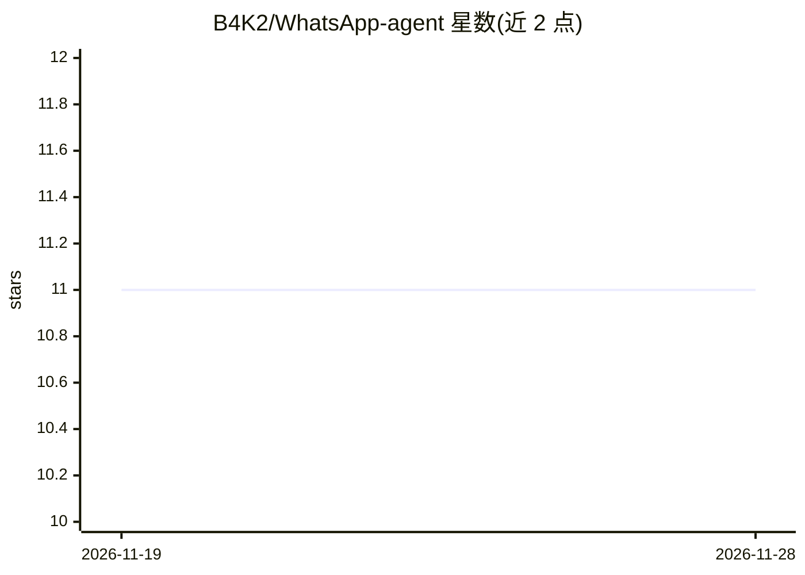

# B4K2/WhatsApp-agent

⭐ 11 · Python · 推送 2026-03-07 · [GitHub](https://github.com/B4K2/WhatsApp-agent) · 个人维护

**用 Google ADK 与 MCP 构建的 WhatsApp 自主消息代理**

该仓库将 WhatsApp 接入 AI agent 环境：Go 桥接程序连接 WhatsApp 多设备 API 并以 SQLite 本地存储消息，Python MCP 服务器暴露发送、搜索、列表等标准化工具，Google ADK agent 负责编排消息撰写、附加免责声明并调用工具发送。安装需 Go、Python 3.9+、UV 包管理器，并用手机 WhatsApp 扫码认证。README 提示存在提示注入风险。

## 筛选速览

| 维度 | 判定 | 备注 |
|---|---|---|
| AI 角色 | `ai-native` | 本体是模型或模型工具 |
| 许可风险 | `none` | — |
| 部署形态 | `None` |  |
| 模型依赖 | — | README 未给出锁定关系 |
| 硬件要求 | — | 无带数字的原话,不猜 |
| 安装摩擦 | `low` | 无编译、无系统依赖或容器化 |
| 成熟度 | — | 结构信号不足 |

## 能力要点

- Go 桥接程序连接 WhatsApp 多设备 API，消息本地 SQLite 存储
- Python MCP 服务器暴露 send/search/list 工具
- 针对 Gemini 的 schema 清洗兼容处理
- agent 自动撰写消息并附加免责声明后发送

## 适用场景

- 从 AI agent 环境直接发送 WhatsApp 消息
- 用自然语言搜索聊天记录与消息
- 基于 MCP 工具集扩展媒体发送等能力

## 场景标签

`AI 助手` · 领域:对话与助手

## 证据(README 行号)

> L5: > An intelligent WhatsApp Agent built with **Google ADK** and the **Model Context Protocol (MCP)**.
> L25: * **Python MCP Server** → exposes standardized tools (send, search, list).
> L26: * **Google ADK Agent** → orchestrates message crafting + disclaimer + sending.

## 星数曲线

2026-11-19 11 → 2026-11-28 11（+0）

---
*卡片 v1 · prompt 1.4 · 生成 2026-11-19 · 置信度 high · 依据 README sha `aaf3a4c6b3f2` · [字段定义](../../DATASET.md)*
