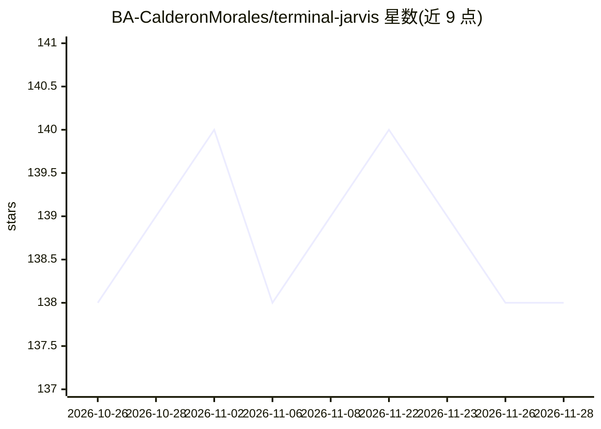

# BA-CalderonMorales/terminal-jarvis

⭐ 138 · Rust · MIT · 推送 2026-11-24 · [GitHub](https://github.com/BA-CalderonMorales/terminal-jarvis) · [官网](https://terminal-jarvis.com) · 个人维护

**统一终端界面管理多个 AI 编码 agent 工具的切换与调用**

一个面向 AI 编码工具（coding-agent harness）的 CLI 编排器：在单个终端界面中列出、检查、安装、更新并切换 25 个已编目的编码 agent，支持 headless 命令与交互式 TUI 两种模式，提供 9 种能力契约、二进制与环境就绪检查、可选的安全门（含 Trivy 扫描）与凭据配置指引。通过 npm、Homebrew、Cargo 分发，也可用 npx 免安装直接运行，Rust 实现，MIT 许可。README 建议在远程开发环境中测试，因其管理的工具可修改文件并执行命令。

## 筛选速览

| 维度 | 判定 | 备注 |
|---|---|---|
| AI 角色 | `ai-ecosystem` | LLM/agent 周边工具 |
| 许可风险 | `permissive` | MIT |
| 部署形态 | `library` | 以包/库形式分发 |
| 模型依赖 | — | README 未给出锁定关系 |
| 硬件要求 | — | 无带数字的原话,不猜 |
| 安装摩擦 | `low` | 无编译、无系统依赖或容器化 |
| 成熟度 | — | 结构信号不足 |

## 能力要点

- headless 与交互式 TUI 双模式，命令面一致
- 编目 25 个 agent 描述符与 225 行能力真值表
- 可选本地安全门，支持 Trivy 扫描与 launch guards
- npm/Homebrew/Cargo 三渠道分发，npx 免安装可用

## 适用场景

- 在多个编码 agent 之间切换统一入口
- 脚本和 CI 中以 headless 方式调用编码 agent
- 安装前检查 agent 二进制与环境就绪状态

## 场景标签

 · 领域:开发者工具/AI 编码基础设施

## 证据(README 行号)

> L3: **Command center for orchestrating context switching between coding-agent harnesses**
> L42: Inspect and safely gate catalog descriptors for Claude, Gemini, Qwen, Pi, Droid and a variety of other AI assistant
> L110: harnesses/<agent>/              # the data plane: one folder per coding agent

## 星数曲线

2026-10-26 138 → 2026-11-28 138（+0）

---
*卡片 v1 · prompt 1.4 · 生成 2026-11-27 · 置信度 high · 依据 README sha `cb1cd5976ce0` · [字段定义](../../DATASET.md)*
