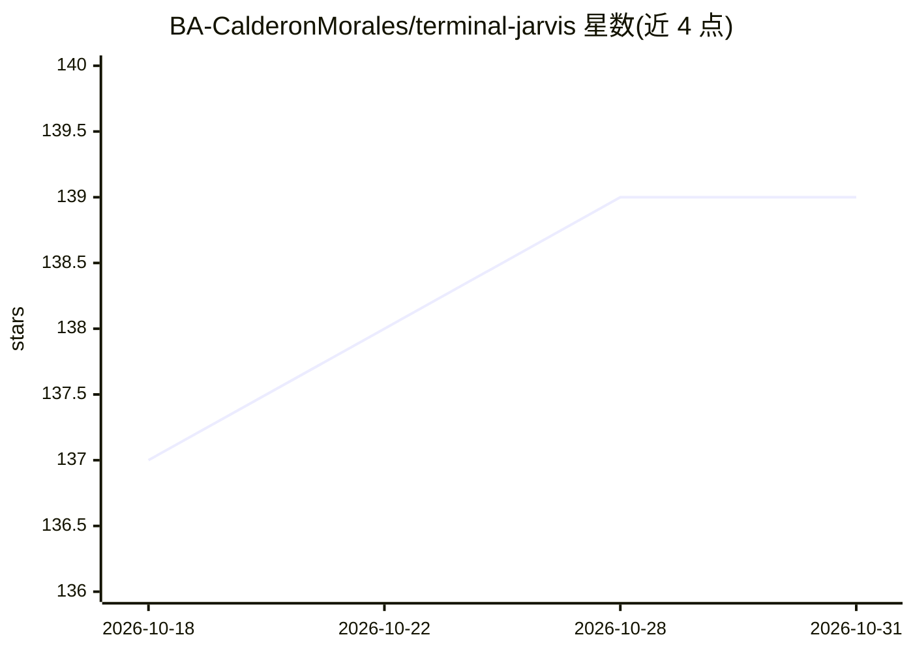

# BA-CalderonMorales/terminal-jarvis

⭐ 139 · Rust · MIT · 推送 2026-10-29 · [GitHub](https://github.com/BA-CalderonMorales/terminal-jarvis) · [官网](https://terminal-jarvis.com) · 个人维护

**终端工具：统一编排与切换各类 AI 编码 agent**

用 Rust 编写的终端命令中心，管理 25 个 AI 编码 harness（Claude、Gemini、Qwen、Pi、Droid 等）的目录描述符：列出、检查、安装、更新、切换与执行能力，支持 headless 单命令与交互式 TUI 两种模式。提供 9 类能力契约、可选本地安全门（含 Trivy 扫描）、传 refuses 危险运行的 launch guards。建议在远程开发环境（Codespaces/DevPod 等）中测试。经 npm、Homebrew、Cargo 或 npx 免安装运行。

## 筛选速览

| 维度 | 判定 | 备注 |
|---|---|---|
| AI 角色 | `ai-ecosystem` | LLM/agent 周边工具 |
| 许可风险 | `permissive` | MIT |
| 部署形态 | `library` | 以包/库形式分发 |
| 模型依赖 | — | README 未给出锁定关系 |
| 硬件要求 | — | 无带数字的原话,不猜 |
| 安装摩擦 | `low` | 无编译、无系统依赖或容器化 |
| 成熟度 | — | 结构信号不足 |

## 能力要点

- 统一目录化管理 25 个 AI 编码 harness 的描述符与 225 行能力矩阵
- headless 与交互式 TUI 双模式，命令面一致
- 可选本地安全门与 Trivy 扫描、危险运行拦截
- npx 免安装按需运行，支持 npm/Homebrew/Cargo 分发与 self-update

## 适用场景

- 在多个 AI 编码 agent 之间快速检查、切换与传参执行
- 用一条命令批量检查各 agent 的二进制与环境就绪状态
- 为脚本与 CI 场景使用 headless 命令编排 agent 任务

## 场景标签

 · 领域:开发者工具/AI agent 编排

## 证据(README 行号)

> L3: **Command center for orchestrating context switching between coding-agent harnesses**
> L42: Inspect and safely gate catalog descriptors for Claude, Gemini, Qwen, Pi, Droid and a variety of other AI assistant
> L57: - Installed globally (npm, Homebrew, or Cargo): `terminal-jarvis list` / `tj list`

## 星数曲线

2026-10-18 137 → 2026-10-31 139（+2）

---
*卡片 v1 · prompt 1.4 · 生成 2026-10-23 · 置信度 high · 依据 README sha `f4a8293df63e` · [字段定义](../../DATASET.md)*
