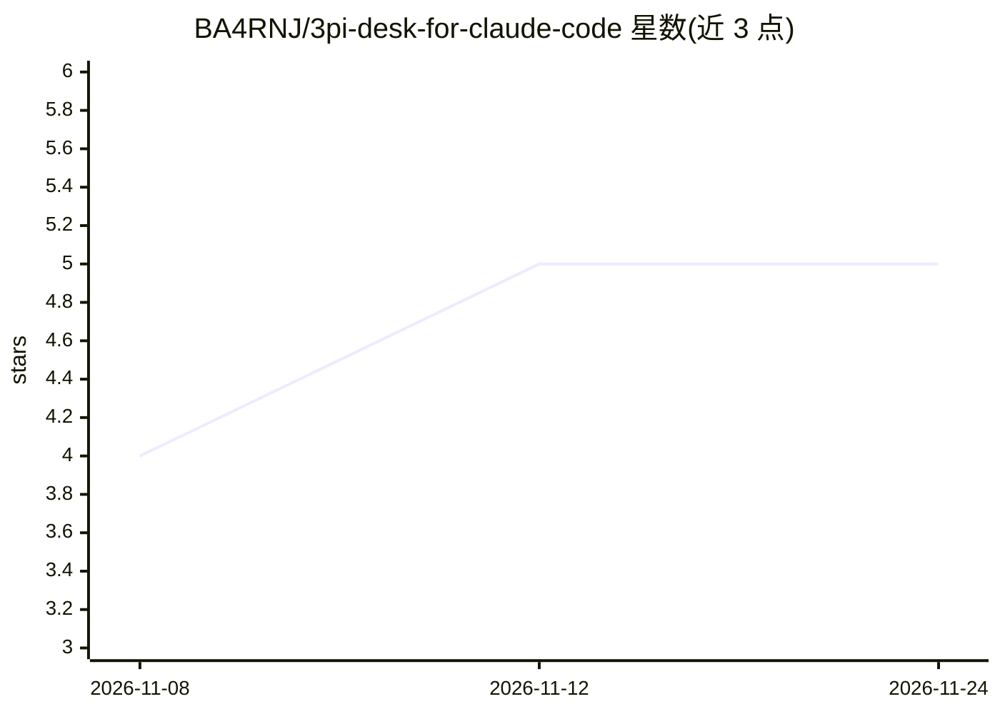

# BA4RNJ/3pi-desk-for-claude-code

⭐ 5 · TypeScript · MIT · 推送 2026-11-23 · [GitHub](https://github.com/BA4RNJ/3pi-desk-for-claude-code) · [官网](https://github.com/BA4RNJ/3pi-desk-for-claude-code#readme) · 个人维护 · 中文 README

**面向中文用户的 Claude Code 图形化桌面客户端**

本地 Electron/SwiftUI 桌面客户端，为 Claude Code 提供图形界面：工作区多标签、行内权限确认、斜杠命令、MCP/插件/Skills/Hooks/Agents 管理、后台会话与会话备份。会话由官方 Claude Agent SDK 执行，本应用仅作界面与配置层，自动写入 ANTHROPIC_* 环境变量到 ~/.claude/settings.json。支持将模型指向任意 Anthropic Messages 兼容 API（内置 DeepSeek、Kimi、GLM、MiniMax、Ollama 等供应商预设）。项目处于早期阶段，Anthropic 云端会话功能在第三方供应商下不可用。

## 筛选速览

| 维度 | 判定 | 备注 |
|---|---|---|
| AI 角色 | `ai-ecosystem` | LLM/agent 周边工具 |
| 许可风险 | `permissive` | MIT |
| 部署形态 | `desktop` | 安装包/桌面程序 |
| 模型依赖 | local-ok | 支持本地模型 |
| 硬件要求 | — | 无带数字的原话,不猜 |
| 安装摩擦 | `low` | 无编译、无系统依赖或容器化 |
| 成熟度 | `idea` | |

## 能力要点

- 内置 DeepSeek/Kimi/GLM/MiniMax/Ollama 等供应商预设，自动写入 ~/.claude/settings.json
- 复用 Claude Code 工作区、权限、插件与会话体系，打包版无需单独安装 CLI
- 图形化管理 MCP、插件市场、Skills、Hooks 与后台会话
- 对话可原地编辑与撤回，删除会话前自动备份

## 适用场景

- 不想在终端使用 Claude Code，改用图形界面工作
- 用 DeepSeek/Kimi 等 Anthropic 兼容 API 驱动 Claude Code
- 在 Windows 上通过 WSLg 运行 Claude Code 图形客户端

## 场景标签

`编码 Agent` · 领域:编码与开发

## 证据(README 行号)

> L73: - **底层是什么。** 会话由官方 **Claude Agent SDK** 执行；Claude Code CLI 优先复用本机安装，
> L108: 设置 → API：内置 OpenCode Go、Anthropic、Z.ai、Moonshot、DeepSeek、MiniMax、Ollama 和自定义

## 星数曲线

2026-11-08 4 → 2026-11-24 5（+1）

---
*卡片 v1 · prompt 1.4 · 生成 2026-11-21 · 置信度 high · 依据 README sha `010aa4823392` · [字段定义](../../DATASET.md)*
