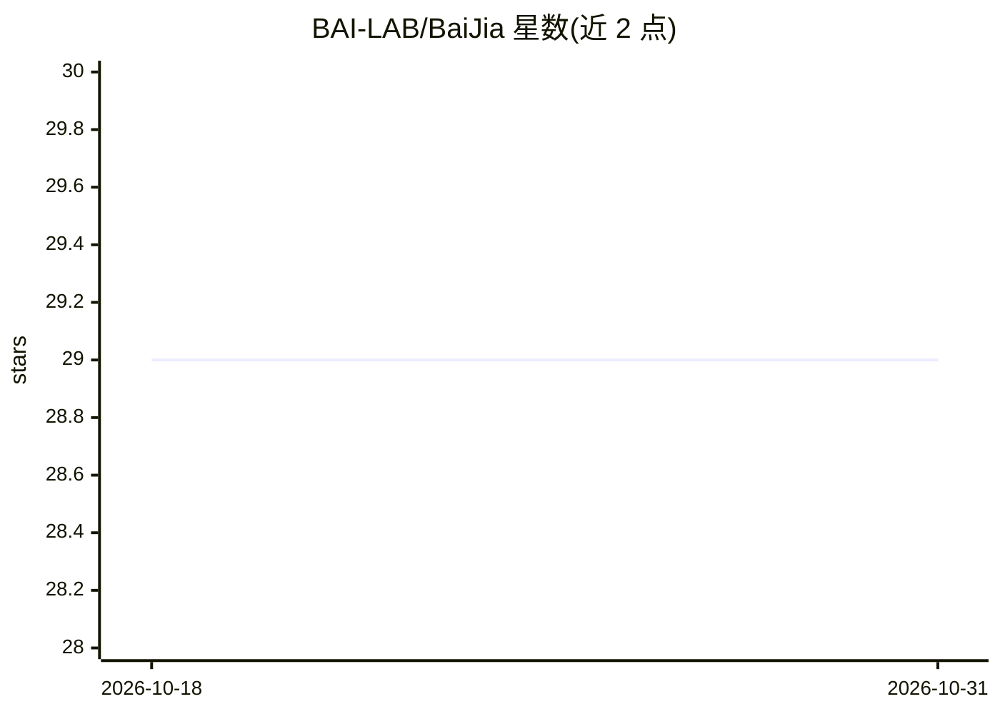

# BAI-LAB/BaiJia

⭐ 29 · 推送 2026-01-14 · [GitHub](https://github.com/BAI-LAB/BaiJia) · [官网](https://baijia.online/home) · 组织维护 · 中文 README

**中国历史人物角色扮演语料库与评测集，供 LLM 微调评测**

面向中文历史人物角色扮演的 agent 语料库：公开 BaiJia_Lite 数据子集用于监督微调实验，配套 Eval_Question 评测问题与 Eval_Resume 人物简历用于评估 LLM 角色扮演能力，并定义角色一致性、对话能力、情感表达等六个评测维度。团队以 Qwen 为基座在 BaiJia_Lite 上做 SFT，将 adapter 模型发布于 Hugging Face，六维评测均给出得分表。另有百家 AI 智能体平台，含 2 万个历史人物智能体，注册用户可获 1000 tokens。

## 筛选速览

| 维度 | 判定 | 备注 |
|---|---|---|
| AI 角色 | `ai-knowledge` | 知识聚合/清单类 |
| 许可风险 | `none` | — |
| 部署形态 | `None` |  |
| 模型依赖 | — | README 未给出锁定关系 |
| 硬件要求 | — | 无带数字的原话,不猜 |
| 安装摩擦 | `low` | 无编译、无系统依赖或容器化 |
| 成熟度 | — | 结构信号不足 |

## 能力要点

- BaiJia_Lite 公开子集 + 评测问题 + 人物简历三部分数据结构
- 六个角色扮演评测维度（CC/DA/CA/EI/CR/CHA）
- 基于 Qwen 的 SFT adapter 已发布于 Hugging Face 并附六维评分
- 配套百家 AI 智能体平台，含 2 万个中国历史人物智能体

## 适用场景

- 用 BaiJia_Lite 做角色扮演方向的监督微调实验
- 按六维评测框架衡量 LLM 的中文历史人物扮演能力
- 体验平台上的中国历史人物角色对话

## 场景标签

`模型评测` `微调` · 领域:评测与运维

## 证据(README 行号)

> L3: BaiJia is a role-playing agent corpus focused on Chinese historical characters. It aims to enhance the role-playing 
> L8: - **Eval_Question**: A set of evaluation questions to assess the performance of LLMs.

## 星数曲线

2026-10-18 29 → 2026-10-31 29（+0）

---
*卡片 v1 · prompt 1.4 · 生成 2026-10-26 · 置信度 high · 依据 README sha `90fbca8d155e` · [字段定义](../../DATASET.md)*
