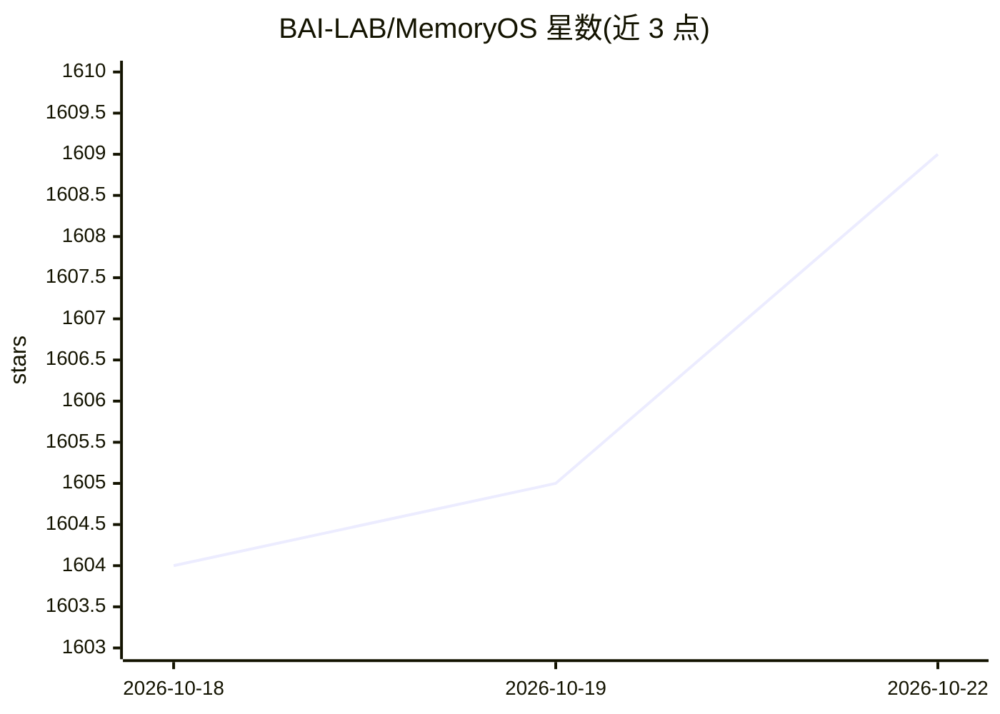

# BAI-LAB/MemoryOS

⭐ 1,609 · Python · Apache-2.0 · 推送 2026-07-07 · [GitHub](https://github.com/BAI-LAB/MemoryOS) · [官网](https://baijia.online/memoryos/) · 组织维护 · 中文 README

**为个性化 AI agent 提供长期记忆管理的记忆操作系统**

面向个性化 AI agent 的记忆管理系统（EMNLP 2025 Oral 论文），借鉴操作系统内存管理思路，采用分层存储架构，含 Storage、Updating、Retrieval、Generation 四个模块，管理短期/中期/长期记忆与用户画像。支持即插即用的记忆模块、通过 MCP Server 为各类 AI 应用注入长期记忆能力，模型调用统一走 OpenAI 接口，支持 OpenAI/Anthropic/Deepseek/Qwen/vLLM 等提供商。提供 PyPI 包、MCP、ChromaDB 版本、Docker 镜像与 Playground 平台；LoCoMo 基准上报告 F1 提升 49.11%。由北邮 BaiJia AI 研究团队维护。

## 筛选速览

| 维度 | 判定 | 备注 |
|---|---|---|
| AI 角色 | `ai-ecosystem` | LLM/agent 周边工具 |
| 许可风险 | `permissive` | Apache-2.0 |
| 部署形态 | `self-host` | docker 或自建部署 |
| 模型依赖 | local-ok | 支持本地模型 |
| 硬件要求 | — | 无带数字的原话,不猜 |
| 安装摩擦 | `low` | 无编译、无系统依赖或容器化 |
| 成熟度 | — | 结构信号不足 |

## 能力要点

- 分层存储架构四模块：Storage/Updating/Retrieval/Generation
- MemoryOS-MCP 通过 add_memory/retrieve_memory/get_user_profile 三类工具为应用注入记忆
- 支持 OpenAI/Anthropic/Deepseek/Qwen/vLLM 等模型提供商（统一 OpenAI 接口）
- 提供 PyPI 包、Docker 官方镜像与 Playground 演示平台

## 适用场景

- 给我的对话 agent 加上跨会话的长期记忆与用户画像
- 在 Claude Desktop/Cline/Cursor 等客户端中通过 MCP 接入记忆能力
- 复现 LoCoMo 长期记忆基准的评测结果

## 场景标签

`Agent 记忆` · 领域:Agent 开发

## 证据(README 行号)

> L26: **MemoryOS** is designed to provide a memory operating system for personalized AI agents, enabling more coherent, p
> L42: * ✨ **Agent Workflow Create with Ease** (**MemoryOS-MCP**)
> L150: All model calls use the OpenAI API interface; you need to supply the API key and base URL.

## 星数曲线

2026-10-18 1,604 → 2026-10-22 1,609（+5）

---
*卡片 v1 · prompt 1.4 · 生成 2026-10-21 · 置信度 high · 依据 README sha `50404d9a1864` · [字段定义](../../DATASET.md)*
