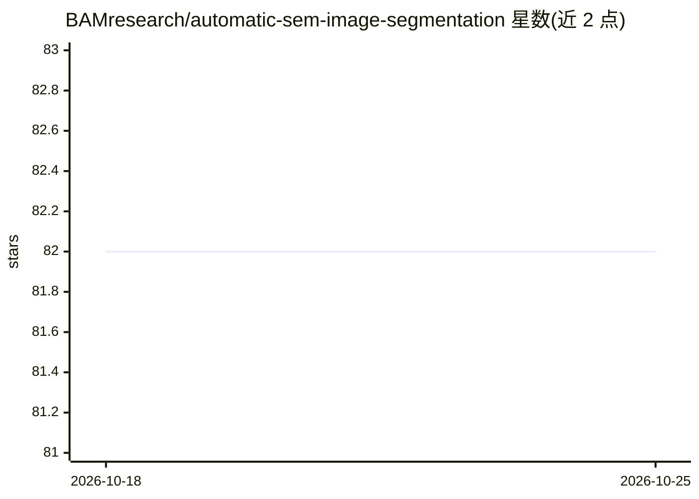

# BAMresearch/automatic-sem-image-segmentation

⭐ 82 · Jupyter Notebook · NOASSERTION · 推送 2026-02-16 · [GitHub](https://github.com/BAMresearch/automatic-sem-image-segmentation) · 组织维护

**电镜颗粒图像自动语义分割工作流（CycleGAN+UNet）**

随 Scientific Reports 论文发布的电镜（SEM/TSEM/TEM）图像分割工作流：通过模拟掩码训练 CycleGAN 生成合成电镜图像，再用 MultiRes UNet 训练分割网络，并含基于手动标注类别训练的分类网络；仓库同时提供论文所用数据集（亦存于 Zenodo）、训练好的模型、示例脚本及可在推理模式调用这些模型的 ImageJ 插件（beta）。1.2.0 版迁移至 Keras v3，可用 tensorflow 或 pytorch 后端运行。用户按 Releases 下载脚本、pip 安装依赖、运行 StartProcess.py 完成训练；需匹配 python/CUDA/cuDNN 版本，GPU 训练、CPU 推理为默认配置。

## 筛选速览

| 维度 | 判定 | 备注 |
|---|---|---|
| AI 角色 | `ai-native` | 本体是模型或模型工具 |
| 许可风险 | `none` | NOASSERTION |
| 部署形态 | `library` | 以包/库形式分发 |
| 模型依赖 | — | README 未给出锁定关系 |
| 硬件要求 | — | 无带数字的原话,不猜 |
| 安装摩擦 | `medium` | 含编译或系统依赖之一 |
| 成熟度 | — | 结构信号不足 |

## 能力要点

- CycleGAN 模拟图像 + MultiRes UNet 分割的完整训练工作流
- 提供论文所用数据集与已训练模型，数据另存 Zenodo
- ImageJ 插件可在推理模式直接调用训练好的网络
- 1.2.0 基于 Keras v3，支持 tensorflow/pytorch 双后端

## 适用场景

- 对团聚非球形颗粒的电镜图像做自动分割与分类
- 用自己的电镜图像与轮廓标注训练定制分割网络
- 在 ImageJ 中直接使用预训练模型进行推理

## 场景标签

`目标检测` · 领域:感知与多模态

## 证据(README 行号)

> L4: B. Ruehle, J. F. Krumrey, V.-D. Hodoroaba, Scientific Reports, _Workflow towards Automated Segmentation of Agglomera
> L14: 	- **Trained Neural Network Models:** Contains the fully trained neural networks for SEM image segmentation trained

## 星数曲线

2026-10-18 82 → 2026-10-25 82（+0）

---
*卡片 v1 · prompt 1.4 · 生成 2026-10-24 · 置信度 high · 依据 README sha `a560c5a00c3e` · [字段定义](../../DATASET.md)*
