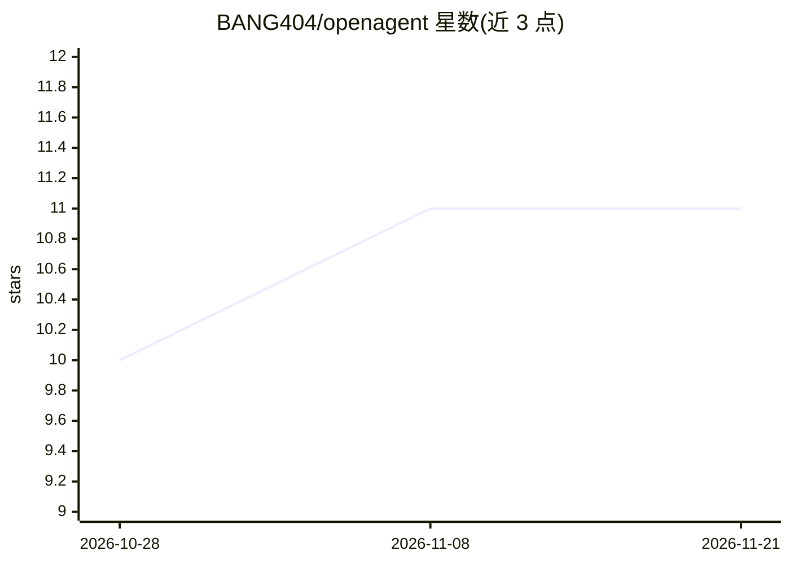

# BANG404/openagent

⭐ 11 · JavaScript · GPL-3.0 · 推送 2026-10-30 · [GitHub](https://github.com/BANG404/openagent) · [官网](https://bang404.github.io/openagent/) · 个人维护 · 中文 README

**多 agent 桌面 AI 客户端：文件/工具/长任务的本地工作台**

基于 Tauri 2 + SvelteKit 2 + Rust 的桌面 agent 应用，覆盖 Windows/macOS/Linux。核心机制：流式聊天界面加可检查项目、编辑文件、运行命令、调用外部工具的 agent；支持子 agent 委派、SKILL.md 技能与角色复用、MCP 服务接入、Agent 插件扩展、全局/工作区记忆与本地混合文本/向量检索；提供三档审批模式与按平台沙箱（Bubblewrap/Seatbelt/Codex sandbox）隔离。模型服务本地配置，数据存本机，但提示词与附件会发送到所配置的模型服务；执行引擎 Rust Runtime 为私有源码，本仓库公开前端与协议层。

## 筛选速览

| 维度 | 判定 | 备注 |
|---|---|---|
| AI 角色 | `ai-native` | 本体是模型或模型工具 |
| 许可风险 | `viral` | GPL-3.0 |
| 部署形态 | `None` |  |
| 模型依赖 | — | README 未给出锁定关系 |
| 硬件要求 | — | 无带数字的原话,不猜 |
| 安装摩擦 | `low` | 无编译、无系统依赖或容器化 |
| 成熟度 | — | 结构信号不足 |

## 能力要点

- 子 agent 委派、会话分支、定时唤醒与检查点回滚
- SKILL.md 技能/角色/插件/MCP 服务四类扩展机制
- 三档审批模式加 Bubblewrap/Seatbelt/Codex 沙箱隔离
- 接入 Feishu/Telegram/QQ/WeChat/Discord/Slack 消息通道与远程浏览器网关

## 适用场景

- 在工作区让 agent 读写文件并执行终端命令完成项目任务
- 通过 SKILL.md 和插件扩展定制专属 agent 工作流
- 在即时通讯平台上远程使用桌面 agent 会话

## 场景标签

`AI 助手` `多智能体` · 领域:Agent 开发

## 证据(README 行号)

> L5:  A desktop AI agent for working with files, tools, and long-running tasks in your workspace.
> L13: OpenAgent combines a streaming chat interface with an agent that can inspect projects, edit files, run commands, an
> L41: You can change services and defaults later from the **Models** menu. OpenAgent supports Anthropic, OpenAI, and comp

## 星数曲线

2026-10-28 10 → 2026-11-21 11（+1）

---
*卡片 v1 · prompt 1.4 · 生成 2026-11-19 · 置信度 high · 依据 README sha `0e4a25a0e24b` · [字段定义](../../DATASET.md)*
